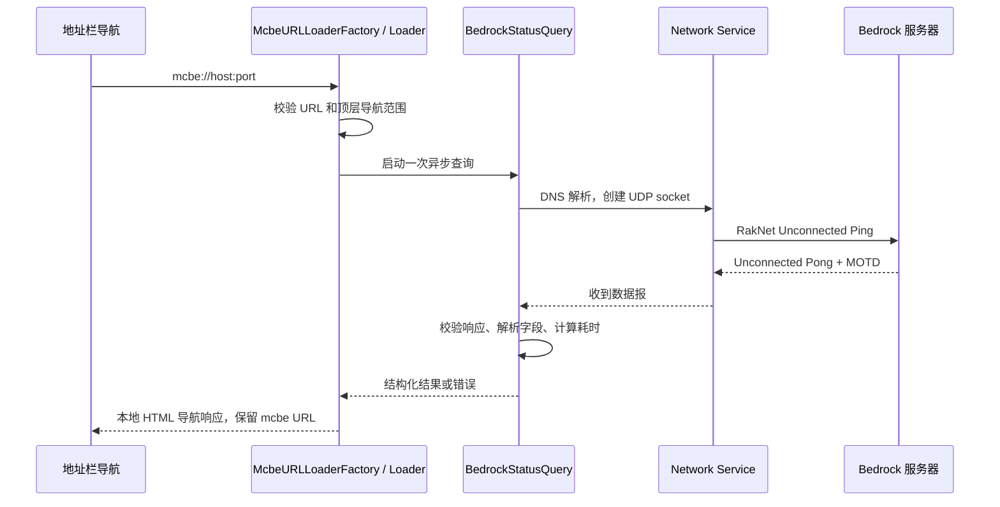

# 原生 mcbe:// 协议与 Bedrock MOTD 结果页实现方案

- 整理日期：2026-11-07
- 项目：Chromium 158.0.8126.0，Windows x64 Debug 组件构建
- 已选方案：原生 `mcbe://` 导航加载器 + 本地生成的结果页。
- 状态：原生 MCBE 导航、异步 UDP 查询与本地结果页已实现，完整构建和最终验证通过。
- 相关现有功能：[chromiumPlus 默认字段实现与验证记录](globalthis-chromium-plus-implementation.md)。两项功能独立，MCBE 查询不依赖该全局字段。

## 1. 目标与第一版行为

用户在地址栏输入 `mcbe://geo.hivebedrock.network`，浏览器通过 UDP 查询 Minecraft Bedrock 服务器的 MOTD，并在当前标签页展示结果。提交导航后，地址栏保留 `mcbe://` URL。

第一版支持以下地址形式：

```text
mcbe://geo.hivebedrock.network
mcbe://example.com:19132
mcbe://192.168.1.10:19132
mcbe://[IPv6地址]:19133
```

未指定端口时使用 UDP `19132`；显式端口范围为 `1..65535`。IPv6 服务器若监听 `19133`，应在 URL 中明确指定，不因地址族变化而擅自替换用户选定端口。

第一版约定：

- 处理顶层文档导航，加载期间显示浏览器原生导航进度。
- 查询完成后返回完整的成功或错误 HTML；刷新页面重新查询。
- URL 路径仅允许空路径或 `/`，暂不定义 query、fragment 和用户信息的语义，遇到这些输入给出明确的地址错误。
- 结果页只使用本地固定模板与样式，按普通内容页面权限运行。
- 不需要 Minecraft 账号、游戏登录或完整 Bedrock 游戏连接。

服务器收藏、多服务器列表、自动轮询、加入游戏、系统级协议关联、Worklet 或网页通用 socket API 不属于第一版。

## 2. 总体结构



职责分离为 URL 接入、协议解析、异步查询、HTML 导航响应四层。解析器保持无网络、无界面依赖；查询服务不拼接 HTML；Loader 不处理 RakNet 字节细节。

## 3. 当前源码中的接入点

| 作用 | 当前入口 |
| --- | --- |
| 在各进程初始化 URL scheme | [ChromeContentClient::AddAdditionalSchemes()](../chrome/common/chrome_content_client.cc) |
| URL authority 的 host/port 类型 | [url::SchemeType](../url/url_canon.h) 与 [url::AddStandardScheme()](../url/url_util.h) |
| 浏览器已处理协议判断 | [ProfileIOData::IsHandledProtocol()](../chrome/browser/profiles/profile_io_data.cc) |
| 地址栏 scheme 分类 | [ChromeAutocompleteSchemeClassifier::GetInputTypeForScheme()](../chrome/browser/autocomplete/chrome_autocomplete_scheme_classifier.cc) |
| 原生非 HTTP 导航工厂 | [ChromeContentBrowserClient::CreateNonNetworkNavigationURLLoaderFactory()](../chrome/browser/chrome_content_browser_client.cc) |
| Content 层工厂选择与导航提交 | [NavigationURLLoaderImpl](../content/browser/loader/navigation_url_loader_impl.cc) |
| UDP Mojo 接口 | [udp_socket.mojom](../services/network/public/mojom/udp_socket.mojom) 与 [network_context.mojom](../services/network/public/mojom/network_context.mojom) |
| 已有 DNS、UDP、定时器和取消示例 | [UdpProberImpl](../chrome/browser/ash/net/network_diagnostics/udp_prober.cc) |
| 工厂生命周期模式参考 | [SelfDeletingURLLoaderFactory](../services/network/public/cpp/self_deleting_url_loader_factory.h) |

### 3.1 Scheme 注册的端口细节

当前 `content/common/url_schemes.cc` 对 `schemes.standard_schemes` 中的条目统一使用 `SCHEME_WITH_HOST`，这个类型不包含端口。

MCBE 应在 scheme registry 锁定前，注册支持 host/port 的标准类型。实际采用 `url::SCHEME_WITH_HOST_PORT_AND_USER_INFORMATION`：`SCHEME_WITH_HOST_AND_PORT` 会在 URL 规范化时静默丢弃用户信息，导致 Loader 无法明确拒绝这类输入。保留用户信息仅供地址校验，Loader 遇到非空用户名或密码会返回地址错误，不发起网络查询。在 `ChromeContentClient::AddAdditionalSchemes()` 中调用 `url::AddStandardScheme()`，不再将同一 scheme 重复加入上述通用列表。覆盖浏览器、Renderer 等所需进程初始化，并用 URL 单元测试确认端口和 IPv6 行为。

在 `ProfileIOData::IsHandledProtocol()` 加入 `mcbe` 后，当前地址栏分类器复用该判断，将该 scheme 分类为 URL。内部导航加载器的分发与提交已由端到端测试验证；本次自动化导航通过 CDP 发起。

第一版只注册完成导航所需的能力，不自动将 scheme 加入 secure、CORS、Service Worker 或 WebUI 特权列表。具体请求、提交和进程 origin 授权应沿导航路径核对，以最小范围支持该结果文档。

## 4. 模块与数据模型

实际目录结构如下；Loader 为 factory 实现文件内的私有类，导航回归由独立 CDP 脚本执行：

```text
chrome/browser/mcbe/
  BUILD.gn
  mcbe_url.h/.cc
  bedrock_status_parser.h/.cc
  bedrock_status_query.h/.cc
  mcbe_result_page.h/.cc
  mcbe_url_loader_factory.h/.cc
  mcbe_url_unittest.cc
  bedrock_status_parser_unittest.cc
  run_all_unittests.cc
chrome/test/mcbe_smoke_test.mjs
```

模块职责：

- `mcbe_url`：将已校验的 URL 转为主机名和端口；拒绝非法输入，避免手工按冒号拆分 IPv6。
- `bedrock_status_parser`：构造 Ping，校验 Pong 并解析 MOTD；只接收字节数据和请求标记。
- `bedrock_status_query`：管理 DNS、socket、重试、总超时和取消，返回结构化结果。
- `mcbe_result_page`：将结果渲染为经过转义的本地 HTML。
- `mcbe_url_loader_factory` / `mcbe_url_loader`：接入导航、请求生命周期、响应头与数据管道。

结果模型至少包含：

| 字段 | 表示方式 |
| --- | --- |
| 主机、查询端口、实际响应端点 | 已校验的目标信息 |
| edition、主标题、副标题、版本、游戏模式 | 字符串，部分字段可选 |
| 协议版本、在线人数、人数上限 | 校验范围后的整数 |
| RakNet GUID、MOTD 中公布的 GUID | 分别保留为十进制字符串，保留完整 64 位精度；两者可以不同 |
| 网络往返耗时、查询完成时间 | 单调时钟计算 RTT；墙上时间用于展示 |
| 原始 MOTD | 有长度上限的文本，便于诊断 |
| 错误类别 | 非法地址、DNS 失败、网络错误、超时、无效响应、取消 |

## 5. RakNet Ping/Pong 的最小实现

### 5.1 请求包

发送 33 字节的 Unconnected Ping：

| 顺序 | 长度 | 内容 |
| --- | --- | --- |
| 1 | 1 字节 | Packet ID：`0x01` |
| 2 | 8 字节 | 时间或请求标记，大端编码，用于回包关联 |
| 3 | 16 字节 | RakNet Magic：`00ffff00fefefefefdfdfdfd12345678` |
| 4 | 8 字节 | 客户端 GUID，大端编码 |

### 5.2 响应包

Unconnected Pong 的布局：

| 顺序 | 长度 | 内容 |
| --- | --- | --- |
| 1 | 1 字节 | Packet ID：`0x1c` |
| 2 | 8 字节 | 请求标记回显 |
| 3 | 8 字节 | 服务器 GUID |
| 4 | 16 字节 | RakNet Magic |
| 5 | 2 字节 | MOTD 字符串字节长度，无符号大端整数 |
| 6 | 变长 | UTF-8 MOTD |

响应固定头共 35 字节。解析前检查最小长度、ID、Magic、请求标记以及声明长度是否落在数据报内。接收缓冲区设置有限上限，例如 8 KiB；截断、越界和不符合约定的响应不能继续按有效结果解析。

常见字符串形式：

```text
MCPE;主标题;协议版本;游戏版本;在线人数;人数上限;服务器GUID;副标题;游戏模式;模式编号;IPv4端口;IPv6端口;
```

实际服务器可能缺少尾部可选字段，或添加额外字段。解析器对必要字段做检查，对可选字段保留缺省值，避免依赖固定的完整字段数量。数字转换不成功或越界时返回可诊断的解析错误。

RakNet 包头 GUID 与 MOTD 第七字段分别解析，不要求相等。公网实测发现两者不同的有效响应；GUID 一致性不能作为回包关联条件。查询使用 connected UDP 端点与随机请求标记进行关联。页面展示包头 GUID；MOTD GUID 不同时额外列出，原始 MOTD 也保留该字段。

参考实现：[mcstatus BedrockClient](https://github.com/py-mine/mcstatus/blob/main/mcstatus/_protocol/bedrock_client.py)。协议处理应遵循项目自己的边界检查和生命周期要求。

## 6. 异步网络查询与生命周期

从当前导航所属的 BrowserContext / StoragePartition 取得 `NetworkContext`，复用 Chromium 的 DNS 和网络服务。建议流程：

1. 接受已校验的 host 和 port，开始总超时计时。
2. 使用 `network::SimpleHostResolver` 解析 A/AAAA 地址；支持直接 IP 输入。
3. 选择目标端点，创建 `network::mojom::UDPSocket` 和 listener。
4. 调用 `Connect()`；成功仅表示本地 socket 配置完成，不代表服务器已经响应。
5. 请求接收数据并发送固定格式 Ping。
6. listener 收到数据后交给纯解析器校验；成功则记录 RTT、关闭 socket 并完成查询。
7. 超时、Mojo 断开、导航取消、Profile 关闭时完成清理，确保结果回调至多执行一次。

建议第一版采用总超时 5 秒、最多 2 次发送，所有重试和多地址回退共享总预算。每次尝试记录请求标记和本地单调时钟时间；IPv4/IPv6 回退仍使用 URL 中确定的端口。

使用 connected UDP 将响应限制在目标端点；其 listener 的 `src_addr` 在该模式下可以为空，不能误判为错误。回包关联依然校验 RakNet 请求标记。

Query 由当前 Loader 持有，采用明确的完成状态、定时器与 WeakPtr。Loader 的 Mojo 连接关闭时取消 Query。异步 DNS 回调、数据报回调和超时回调应统一汇入一次性完成函数。

UI 线程只执行异步调度和小规模解析，不做阻塞 DNS、socket 等待或同步网络读取。发送调用需提供项目约定的网络流量注解。

## 7. 导航响应与结果页

`CreateNonNetworkNavigationURLLoaderFactory()` 为 `mcbe` 返回专用工厂。工厂绑定当前导航上下文，Loader 校验请求为支持的顶层文档请求，启动查询并通过 `URLLoaderClient` 返回 `text/html; charset=utf-8` 响应。

具体需要处理：

- 当前 frame 是否为支持的主框架，拒绝不支持的子框架或资源请求路径。
- 请求 URL、方法、端口和输入长度校验。
- 正常响应头、Mojo data pipe 写入、完成状态和连接断开。
- 请求取消、Profile 关闭以及中途切换导航的清理。
- 页面刷新产生新查询，地址栏、历史、后退前进和 origin 行为符合预期。

成功结果页展示服务器地址、主标题、副标题、版本、人数、游戏模式、RTT 和查询时间。错误结果页保留目标地址与错误说明，用户可通过浏览器刷新重试。

结果页第一版不需要 JavaScript：由本地固定模板生成完整 HTML，可使用固定内联样式，配置如 `default-src 'none'; style-src 'unsafe-inline'` 的 CSP。避免加载服务器提供的远程资源。

实现时为 `mcbe` 注册 `no_access_schemes`，让每个结果文档使用独立的 opaque origin，不获得 WebUI、共享同源存储或跨页面访问能力；地址栏仍保留完整的 MCBE URL。当前 `url::SchemeHostPort` 在 scheme 没有内置默认端口时，序列化 tuple origin 会省略端口，因此第一版不暴露这种有歧义的 origin，也不为这项功能修改通用 URL 层的默认端口表。URL 解析与 UDP 查询仍保留用户指定端口，默认值由查询地址解析器确定为 `19132`。

所有远端文本和错误文本都按上下文转义后输出。MOTD 的 `§` 格式码第一版可移除后显示纯文本；后续实现彩色文本时，映射为固定样式，而非将 MOTD 当 HTML 插入。

用户可见错误应区分 DNS 失败、发送/接收失败、无效数据和等待超时。超时表示“未收到响应”，不能据此确认服务器离线。

## 8. 实施步骤与阶段验收

### 阶段一：URL 语义与注册

1. 新增统一的 MCBE scheme 常量。
2. 使用带 host/port 的标准 scheme 类型注册，并接入内部已处理协议判断。
3. 实现 URL 校验与端口默认值。
4. 编写域名、IPv4、IPv6、非法端口、空主机及不支持组成部分的测试。

验收：地址栏输入 MCBE URL 被识别为导航；host、port 和 origin 解析符合约定。

### 阶段二：纯协议与解析器

1. 实现固定格式 Ping 构造与大端编解码。
2. 实现 Pong 头检查、长度检查和 MOTD 解析。
3. 定义可选字段、数值范围和错误模型。
4. 加入有效响应、截断、错误 Magic/ID/标记、非法长度、缺失可选字段和数值越界的测试。

验收：解析器可在无网络条件下确定性验证。

### 阶段三：异步 UDP 查询

1. 实现 DNS、UDP remote/listener、超时和一次性完成函数。
2. 加入有预算的重试与地址回退。
3. 接入取消、Mojo 断开和 Profile 生命周期清理。
4. 通过本地模拟 UDP 服务器测试请求和响应，不依赖公网可用性。

验收：正常响应、无响应、畸形包、取消和服务断开均能按时完成，不阻塞 UI。

### 阶段四：本地 HTML 生成与导航工厂

1. 实现结果模板、纯文本转义及错误页。
2. 实现 LoaderFactory / Loader 并注册到 Chrome BrowserClient。
3. 完成响应头、data pipe、完成通知和请求取消。
4. 在适当 GN target 中加入源码、资源和测试。

验收：访问 `mcbe://host:port` 展示结果，地址栏保留 MCBE URL，刷新可重新查询。

### 阶段五：构建与端到端验证

1. 运行针对性的单元测试和浏览器测试。
2. 执行 `autoninja -C out/Debug chrome` 完成产品增量构建。
3. 使用本地模拟服务器验证导航、刷新、非法地址、超时页和取消。
4. 使用 Hive 进行额外的公网 UDP 查询和页面展示验证。
5. 更新本文的实施记录，将源码和测试作为后续功能提交保存。

## 9. 测试矩阵与现有环境限制

| 层次 | 至少覆盖 |
| --- | --- |
| URL | 默认端口、显式端口、IPv4/IPv6、规范化、非法输入 |
| 协议 | 正常包、截断、错误标记/Magic、长度和数值边界、可选字段 |
| 网络 | DNS 失败、多地址回退、超时、重试、无效数据、取消和断连 |
| 导航 | 地址栏输入、刷新、历史、主框架范围、Loader 生命周期 |
| 页面 | UTF-8、HTML 转义、MOTD 格式码、错误信息和字段缺省 |
| 集成 | 本地假服务器的确定性测试，加一次公网服务器实测 |

此前验证 `chromiumPlus` 时，本机默认无头模式的独立网络服务曾崩溃重启；临时使用 `--enable-features=NetworkServiceInProcess2` 后测试通过。MCBE 查询将直接依赖 NetworkContext，因此实施时应分别验证默认网络服务模式与该诊断模式，不能只凭诊断参数下通过就宣称默认模式已验证。

该参数仅用于定位和运行验证，不作为 MCBE 功能硬编码到浏览器启动逻辑。

## 10. 已完成的协议可行性验证

2026-11-07，从当前环境向 `geo.hivebedrock.network:19132` 发送一次合法 Unconnected Ping，收到通过 ID、Magic、回显标记和长度检查的 Unconnected Pong。

当次响应字段为：

```text
edition: MCPE
MOTD: HIVE-O-WEEN | BEDWARS S5
protocol: 944
version: 1.26.14.1
players: 12616 / 100000
server GUID: 6385290742739111559
subtitle: Hive Games
gamemode: Survival
```

这些数据仅为实施前原始 UDP 可行性查询的快照，不作为后续测试的固定预期。原生 MCBE scheme、Loader 和结果页的实施验证另见下一节。

## 11. 本次实施记录

### 11.1 已落地的模块

- [mcbe_url](../chrome/browser/mcbe/mcbe_url.cc)：使用 GURL 解析主机、IPv6 和端口，默认 UDP `19132`，校验输入长度与不支持的地址组成部分。
- [bedrock_status_parser](../chrome/browser/mcbe/bedrock_status_parser.cc)：纯 Ping / Pong 构造和解析。要求声明长度与数据报一致，分别保留包头和 MOTD 的 GUID，支持缺失尾部可选字段及扩展游戏模式编号。
- [bedrock_status_query](../chrome/browser/mcbe/bedrock_status_query.cc)：异步 DNS 与 connected UDP；DNS 包含在 5 秒总预算内，最多两次尝试，优先给另一地址族一次回退机会。每次尝试最多处理 16 个无效数据报，单包上限 8 KiB。销毁查询会取消 DNS、定时器、socket 和 listener。
- [mcbe_result_page](../chrome/browser/mcbe/mcbe_result_page.cc)：固定中文结果页和错误页；转义远端文本，展示目标、端点、MOTD、版本、人数、游戏模式、GUID、RTT 和 UTC 查询时间，支持展开原始 MOTD。
- [mcbe_url_loader_factory](../chrome/browser/mcbe/mcbe_url_loader_factory.cc)：在同一实现文件内封装私有 Loader，绑定当前 WebContents，仅接受主框架 GET 文档导航。通过预先写好的有界 data pipe 返回 HTML，连接断开或 WebContents 销毁时清理查询。
- [mcbe_smoke_test.mjs](../chrome/test/mcbe_smoke_test.mjs)：使用 Node 内置 UDP、WebSocket 和 CDP，启动独立临时 Profile 的浏览器，自动检查导航与生命周期；测试退出时只清理其启动的进程和临时目录。

scheme 的 URL 注册、已处理协议判断和 BrowserClient 工厂分发也已接入。没有新增网页通用 UDP API，没有改写为 `chrome://` 页面；结果文档使用独立 opaque origin。

### 11.2 验证命令与记录

```powershell
autoninja -C out/Debug chrome mcbe_unittests
out/Debug/mcbe_unittests.exe --test-launcher-jobs=1 --test-launcher-summary-output=out/Debug/mcbe-unit-results.json
node chrome/test/mcbe_smoke_test.mjs --chrome-binary=out/Debug/chrome.exe --output=out/Debug/mcbe-smoke-default.json --public-host=geo.hivebedrock.network
node chrome/test/mcbe_smoke_test.mjs --chrome-binary=out/Debug/chrome.exe --output=out/Debug/mcbe-smoke-in-process.json --public-host=geo.hivebedrock.network --screenshot=out/Debug/mcbe-result.png --chrome-arg=--enable-features=NetworkServiceInProcess2
python chrome/test/chromium_plus_smoke_test.py --chrome-binary out/Debug/chrome.exe --output out/Debug/chromium-plus-mcbe-regression.json --chrome-arg=--enable-features=NetworkServiceInProcess2
```

单元测试覆盖地址和端口边界、IPv6、opaque origin、报文布局、每个截断前缀、错误 ID / Magic / 标记、UTF-8、数值范围、可选字段、GUID 精度及两个 GUID 不同的有效响应。最终运行结果在下面记录。

本次完整链接暴露了原有构建目录中若干损坏的 `.obj`（异常节编号、乱码符号、越界重定位及损坏的 CodeView 类型记录），已定位并逐个重新生成；这些修复仅涉及 `out/Debug/` 内的构建产物。

最终运行结果：

| 验证 | 结果 |
| --- | --- |
| `autoninja -C out/Debug chrome mcbe_unittests` | 通过 |
| URL / RakNet 单元测试 | 11 / 11 通过 |
| 默认独立网络服务模式的 MCBE 浏览器检查 | 18 / 18 通过 |
| `NetworkServiceInProcess2` 诊断模式的 MCBE 浏览器检查 | 18 / 18 通过 |
| 原有 `chromiumPlus` 回归，诊断模式 | 15 / 15 通过 |
| GN 头文件依赖、C++ / GN 格式、Node 语法、Git 空白检查 | 通过 |

浏览器检查覆盖原生导航、UTF-8、HTML 转义、完整 GUID 精度、opaque origin、CSP、刷新、丢包重试、无关回包、缺失可选字段、GUID 不同、畸形响应、总超时、非法地址不发包、导航取消、子框架 / fetch 限制、DNS 与地址回退、IPv6、历史导航、公网服务器和关闭浏览器时的取消行为。测试脚本使用页面的 `history.back()` / `history.forward()` 验证历史导航，并容忍导航切换期间执行上下文被替换的 CDP 瞬态错误。

两种模式均成功访问 `mcbe://geo.hivebedrock.network/`，结果页标题为 `HIVE-O-WEEN | BEDWARS S5`，副标题为 `Hive Games`。2026-11-07 02:43 UTC 的两次最终查询显示在线人数分别为 `12416 / 1000`、`12413 / 1000`，版本 `1.0`、协议 `121`；包头 GUID 为 `1793329160128393`，MOTD GUID 为 `1208858288862531053`。这些均按收到的响应展示，不以预期版本或人数覆盖。当前环境解析得到的端点是 `198.18.1.131:19132`，不应将它视为 Hive 的固定公网 IP；返回值也可能随时间和网络路径变化。

测试结果保存在 `out/Debug/mcbe-unit-results.json`、`mcbe-smoke-default.json`、`mcbe-smoke-in-process.json` 和 `chromium-plus-mcbe-regression.json`，Hive 结果页截图为 `out/Debug/mcbe-result.png`。已检查截图中的中文、字段布局与完整 GUID 展示；这些产物由构建目录忽略，不加入源码提交。

默认模式启动阶段仍出现一次既有网络服务自动重启日志，随后恢复，本轮 18 项 MCBE 检查全部通过。诊断参数只用于另一组测试，产品不依赖该参数。

### 11.3 URL 行为说明

- 初次导航包含不支持的路径、query、fragment 或非空用户信息时，Loader 返回本地地址错误页。已经提交后的纯 fragment 变化遵循浏览器的同文档导航规则，不重新发起 UDP 查询。
- GURL 已判为无效的输入（例如超出 `65535` 的端口）可能先由 Chromium 标准错误页处理，无法进入自定义 Loader；有效 URL 中的端口 `0` 则由 MCBE 地址校验拒绝。
- 主机和端口采用 GURL 规范化结果。每个结果文档的 origin 独立；刷新会重新查询，历史导航可按浏览器正常文档恢复规则展示已有结果。
