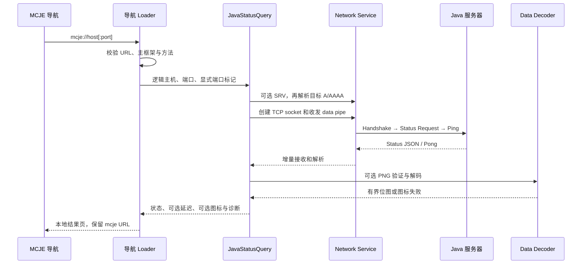

# 原生 mcje:// 协议与 Java 服务器状态、图标结果页首版实现方案

- 整理日期：2026-11-07（Asia/Shanghai）
- 项目：Chromium 158.0.8126.0，Windows x64 Debug 组件构建。
- 当前基础：提交 `23aca714af` 已实现原生 MCBE 导航、Bedrock UDP 查询和本地结果页。
- 已选方向：原生 `mcje://` 导航加载器 + Java Server List Ping（SLP）+ 本地生成结果页。
- 状态：本文保存首版设计、实施顺序和验收要求；MCJE 功能尚未实现。
- 相关文档：[MCBE 实现方案与验证记录](mcbe-native-protocol-implementation.md)、[chromiumPlus 默认字段实现与验证记录](globalthis-chromium-plus-implementation.md)。

## 1. 首版目标与范围

访问 `mcje://mc.hypixel.net`，浏览器通过 TCP 查询 Java 服务器状态，在当前标签页展示 MOTD、版本、协议号、在线人数、延迟和服务器图标。地址栏保留 MCJE URL，刷新会重新查询。

首版范围：

- 支持现代 Java SLP 报文格式（Minecraft Java 1.7 起使用的状态查询流程）。
- 支持域名、IPv4、方括号 IPv6、显式端口，以及未指定端口时的 DNS SRV 发现。
- MOTD 先转换为经过 HTML 转义的纯文本，支持字符串和常见文本组件结构。
- 将状态 JSON 的可选 `favicon` 附件解析为 PNG，在页面内显示标准 64×64 图标；缺失或损坏图标不影响其他状态信息。
- 展示目标地址、实际连接端点、SRV 目标、查询时间及有长度限制的响应 JSON 摘要。
- 继续使用固定本地 HTML / CSS，页面不需要 JavaScript。

首版中的 icon 指状态响应自带的 `favicon`，不是从服务器网站抓取 `/favicon.ico`。独立 PNG 文件下载、标签页 favicon 集成、彩色富文本 MOTD、玩家样本列表、自动轮询、游戏登录与加入服务器留到后续版本。

## 2. URL 语义与权限边界

支持示例：

```text
mcje://mc.hypixel.net
mcje://example.com:25565
mcje://example.com:25570/
mcje://192.168.1.10:25565/
mcje://[::1]:25565/
```

| 输入 | 逻辑端口 | SRV 行为 |
| --- | --- | --- |
| 域名，未写端口 | 25565 | 尝试 `_minecraft._tcp.<主机>`，无可用结果时回退 |
| 域名，显式写 `:25565` 或其他有效端口 | 用户指定端口 | 跳过 SRV |
| IPv4 / IPv6 字面量 | 未指定则 25565 | 跳过 SRV |

URL 校验沿用 MCBE 的规则：URL 长度不超过 2048 字节，路径仅为空或 `/`，拒绝非空用户信息、query 和初始导航中的 fragment，端口范围 `1..65535`。对握手主机名另做协议长度检查，规范化后的 ASCII 主机名不超过 255 字节。IPv6 连接使用去掉方括号的主机字符串，页面继续显示规范化 URL。

地址模型必须额外保存 `port_was_explicit`，不能只保存计算后的 `25565`，否则无法区分隐式默认端口与显式端口。还需分别保存原始逻辑目标、SRV 目标和最终 IP 端点。

注册统一常量 `chrome::kMcjeScheme`，在各相关进程初始化时使用 `SCHEME_WITH_HOST_PORT_AND_USER_INFORMATION` 注册标准 URL，并加入 `no_access_schemes`。保留用户信息供 Loader 拒绝输入，处理方式与 MCBE 一致。结果文档采用独立 opaque origin，不获得 WebUI、共享同源存储、CORS、Service Worker 或 secure scheme 能力。

仅接受当前主框架的 GET 文档导航；iframe、fetch、图片或其他资源请求不能触发 MCJE TCP 查询。初始地址无效时不建立连接。已经提交后的纯 fragment 变化遵循浏览器同文档导航规则，不重新查询。GURL 已判为无效的输入可能先由 Chromium 标准错误页处理。

## 3. 总体结构与当前源码接入点



| 作用 | 当前源码入口 |
| --- | --- |
| scheme 常量与注册 | [url_constants.h](../chrome/common/url_constants.h)、[ChromeContentClient::AddAdditionalSchemes()](../chrome/common/chrome_content_client.cc) |
| 已处理协议与地址栏分类 | [ProfileIOData::IsHandledProtocol()](../chrome/browser/profiles/profile_io_data.cc)、[ChromeAutocompleteSchemeClassifier](../chrome/browser/autocomplete/chrome_autocomplete_scheme_classifier.cc) |
| 非 HTTP 导航分发 | [CreateNonNetworkNavigationURLLoaderFactory()](../chrome/browser/chrome_content_browser_client.cc) |
| 已有 Loader 生命周期与响应写入模式 | [mcbe_url_loader_factory.cc](../chrome/browser/mcbe/mcbe_url_loader_factory.cc) |
| DNS / SRV Mojo 接口 | [host_resolver.mojom](../services/network/public/mojom/host_resolver.mojom) |
| SRV 提取、优先级与权重排序 | [dns_response_result_extractor.cc](../net/dns/dns_response_result_extractor.cc) |
| TCP 连接与收发流 | [NetworkContext::CreateTCPConnectedSocket()](../services/network/public/mojom/network_context.mojom)、[tcp_socket.mojom](../services/network/public/mojom/tcp_socket.mojom) |
| 异步 data pipe 监听 | [SimpleWatcher](../mojo/public/cpp/system/simple_watcher.h) |
| 隔离图片解码 | [decode_image.h](../services/data_decoder/public/cpp/decode_image.h)、[image_decoder.mojom](../services/data_decoder/public/mojom/image_decoder.mojom) |
| Base64、JSON 与 PNG 编码 | [base64.h](../base/base64.h)、[json_reader.h](../base/json/json_reader.h)、[png_codec.h](../ui/gfx/codec/png_codec.h) |

建议新增模块：

```text
chrome/browser/mcje/
  BUILD.gn
  mcje_url.h/.cc
  java_status_resolver.h/.cc
  java_status_protocol.h/.cc
  java_status_query.h/.cc
  java_server_icon.h/.cc
  mcje_result_page.h/.cc
  mcje_url_loader_factory.h/.cc
  *_unittest.cc
  run_all_unittests.cc
chrome/test/mcje_smoke_test.mjs
```

URL、SRV 解析、纯协议解析、TCP 查询、图片处理和页面生成分别承担独立职责。参考 MCBE 的 Loader 模式接入导航；两条路径可验证后，再提取实际共用的响应构造、固定样式和转义辅助函数。Bedrock UDP 与 Java TCP 查询继续使用各自的协议和结果模型。公共函数提取必须回归 MCBE，不能扩大其 CSP 或请求权限。

## 4. DNS SRV 与虚拟主机路由

查询 `_minecraft._tcp.<逻辑主机>` 时设置 `DnsQueryType::SRV`。SRV 的目标主机和端口通过 `ResolveHostClient::OnHostnameResults()` 返回，随后等待 `OnComplete()` 确认完成；不能把空的 `AddressList` 误判为 SRV 失败。

当前 `SimpleHostResolver` 的便捷回调只提供地址结果，不足以直接获取 SRV 主机列表。为 MCJE 实现专用 resolver，使用 NetworkContext 的 ResolveHost 接口，保留取消和断连处理。复用 Chromium 已按优先级及权重生成的目标顺序，不在业务层重新随机排序。

发现流程：

1. 显式端口或 IP 字面量直接进入 A/AAAA 解析或地址构造。
2. 其余域名启动 SRV 查询；本阶段最多占用 1 秒，同时受 5 秒网络总预算限制。
3. 有可用 SRV 记录时，从排序后的候选目标解析 A/AAAA；校验目标和端口，避免无界遍历。
4. 没有可用 SRV、查询失败或该阶段超时时，记录原因，使用原域名与逻辑默认端口继续查询。剩余预算不重置。
5. SRV 已选出目标后，连接失败只在有界候选中回退，不再静默改连原始默认端口。

当前 Chromium 的 `ExtractServiceResults()` 会过滤指向根域名的 SRV 目标，因此高层接口不能区分“仅有 target 为 `.` 的记录”和“没有可用 SRV 目标”。首版遵循现有接口，将空目标结果按上述回退处理；精确区分这种显式服务不可用记录需要后续扩展解析结果接口。

握手使用用户输入经规范化后的逻辑主机名和逻辑端口，TCP 则连接 SRV / DNS 选出的实际端点。例如输入 `mcje://example.com`，SRV 指向 `backend.example.net:25570`，TCP 连接后者，握手保留 `example.com:25565`。这两个地址必须独立保存和测试，不能把解析后的 IP 直接写进握手，影响代理服的虚拟主机路由。

## 5. Java SLP 编解码与结果模型

### 5.1 发送与接收流程

首版使用集中定义的探测协议号 `47`（Java 1.8），作为状态握手中的客户端协议参数。它不是服务器实际版本；服务器返回的 `version.name` 和 `version.protocol` 独立展示。后续若增加其他探测协议号，应通过显式兼容策略和测试调整，不自动遍历大量版本。

报文使用现代 SLP 的未压缩帧格式：`VarInt(报文长度) + VarInt(Packet ID) + Payload`。

| 报文 | ID | 关键内容 |
| --- | --- | --- |
| Handshake | `0x00` | 客户端协议号、UTF-8 逻辑主机名、无符号大端 16 位逻辑端口、`next_state = 1` |
| Status Request | `0x00` | 空 payload，处于 status 状态 |
| Status Response | `0x00` | VarInt 字节长度与 UTF-8 JSON 字符串 |
| Ping | `0x01` | 8 字节大端随机关联值 |
| Pong | `0x01` | 回显同一个 8 字节值 |

连接完成后，按顺序提交 Handshake、Status Request 和 Ping，不把发送 Ping 绑定在收到 JSON 之后，以兼容等待 Ping 才及时刷新响应的实现。记录 Ping 提交发送管道时的单调时钟时间，收到匹配 Pong 后计算客户端观测到的往返耗时。

接收端独立记录有效状态和匹配 Pong，处理一次读到多个帧或一个帧分多次到达。VarInt 解析结果区分“数据不足”“有效值”“格式无效”；拒绝超过 5 字节、溢出、负长度、超过应用上限和与字段布局不符的报文。已知报文必须校验 payload 消费完整，避免把后一个帧误当作当前 JSON 的尾部。

JSON 是必要的状态结果，Pong 用于补充延迟。两者齐备即可结束；状态已有效但 Pong 缺失、连接关闭或等待时间耗尽时保留状态，将延迟显示为“未取得”。收到有效状态后，等待 Pong 最多使用剩余总预算中的 1 秒。无有效状态时，连接错误、非法数据和超时分别返回可诊断错误。

### 5.2 JSON 与文本组件

响应根节点必须是对象，`description` 必须存在且可按受支持的文本组件结构解释。`version`、`players` 可以缺省，缺失时显示“未提供”；出现时校验字段类型和数字范围。额外字段不导致整体解析失败。

- `description` 支持字符串、数组，以及含 `text`、`extra` 的对象；保留换行。
- `translate` 有文本 `fallback` 时优先使用，否则保留翻译键和有界参数文本；首版不加载翻译资源。
- 已知 `§` 格式码按现有纯文本策略移除。颜色与粗体等富文本样式后续再实现。
- 不执行文本组件中的点击、悬停或命令事件，不把组件当 HTML。
- 在线人数和人数上限使用非负、范围内整数；不因服务端报告在线人数大于上限就拒绝状态。
- 图标始终是可选附件，验证失败单独记录，不把有效 JSON 状态改成查询失败。

建议结果模型：

| 字段 | 表示方式 |
| --- | --- |
| 逻辑目标 | host、logical_port、port_was_explicit、规范化 URL |
| 发现与连接信息 | 可选 SRV host/port、实际 IP 端点、回退说明 |
| 状态 | 纯文本 MOTD、可选版本名称与协议号、可选在线人数和上限 |
| 时延 | 可选 Ping/Pong RTT，不用 DNS / 连接耗时冒充 RTT |
| 图标 | 经过验证和重新编码的 PNG 字节，或缺失 / 无效原因 |
| 诊断 | 响应 JSON 摘要、可选附件与延迟诊断、完成时间 |
| 错误 | 地址、DNS、连接、网络超时、协议或 JSON 无效等类别 |

## 6. 服务器图标处理

图标来源只接受 `favicon` 字符串中的精确 PNG data URL 格式：

```text
data:image/png;base64,<Base64 数据>
```

处理顺序：

1. 在 Base64 解码前检查前缀与编码长度；解码后 PNG 文件最多 64 KiB。
2. 检查 PNG signature 和首个 IHDR，要求宽、高均为 64；拒绝其他格式和尺寸。
3. 使用 Data Decoder 服务进行隔离解码，关闭缩小适配，限制解码位图内存，验证结果仍为 64×64。
4. 当前 `ImageCodec::kPng` 只适用于 Ash；Windows 使用 `kDefault`，由前置 PNG 格式检查与后置位图校验约束输入和输出。
5. 将解码得到的单帧位图重新编码成 PNG，再检查输出上限，生成本地受控的 `data:image/png;base64,...`。
6. 将受控 data URL 放入固定 `` 模板，设置宽高与替代文本；解码失败、服务断连或图标阶段超时使用文本占位。

不接受服务器提供的远程图片 URL、SVG、任意 MIME 类型或 HTML 片段。解码服务只接收已通过前置限额的输入。PNG 重新编码避免把服务器原始的附加元数据直接传给结果文档；动画输入只使用解码得到的单帧结果。

## 7. 异步生命周期与限额

Query 由当前导航 Loader 持有，通过 BrowserContext / StoragePartition 获取 NetworkContext。DNS、SRV、TCP socket、SocketObserver、收发 data pipe、SimpleWatcher 和图片解码回调统一纳入取消管理。

| 项目 | 首版约定 |
| --- | --- |
| 网络查询总预算 | 5 秒，覆盖 SRV、DNS、TCP、请求写入、状态与 Pong 等待 |
| SRV 阶段预算 | 最多 1 秒，占用上述总预算 |
| 连接尝试 | 最多 2 个候选 IP 端点，共享预算，兼顾地址族回退 |
| 状态已到达后的 Pong 等待 | 最多 1 秒，且不超过网络剩余预算 |
| 可选图标处理 | 网络结果完成后最多追加 2 秒；失败仍返回状态 |
| 单个状态帧与 TCP 累计输入 | 分别至多 1 MiB、2 MiB，限制未知帧数量，避免无界等待与累积 |
| JSON 深度 | 至多 64 层 |
| 文本组件遍历 | 深度至多 32 层、节点至多 1024、输出文本至多 16 KiB |
| 图标输入 / 重编码输出 | PNG 字节分别至多 64 KiB，Base64 字符串按对应膨胀量预先限长 |
| 图标位图 | 64×64，解码内存上限建议 64 KiB，禁止通过缩小超大图片满足尺寸限制 |
| 页面 JSON 摘要 | 图标内容替换为说明后，最多保留 32 KiB，按 UTF-8 边界截断并明确标注 |
| 本地 HTML 响应 | 保持 512 KiB 上限，按 HTML 转义和 Base64 编码后的实际长度核算 |

候选地址与 SRV 记录只进行有界选取，不为每个地址重新获得完整 5 秒。阶段计时器和总计时器统一汇入一次性完成入口，检查完成状态并使过期 WeakPtr 回调失效。

离开页面、取消导航、Loader Mojo 断开、WebContents 销毁和 Profile 关闭时停止查询，关闭 socket 与 data pipe，撤销 watcher、DNS 及解码回调。所有网络与解码操作异步执行；UI 线程不做阻塞 socket 读取。为 TCP 状态查询增加项目要求的网络流量注解。

## 8. 本地结果页与响应头

页面展示：服务器图标或占位、MOTD、MCJE 地址、逻辑主机和端口、可选 SRV 目标、实际端点、版本和协议号、人数、可选延迟、查询时间，以及可展开的响应 JSON 摘要。JSON 摘要明确标注图标内容已单独处理和可能的截断，不把它宣称为完整原始响应。

沿用固定模板、全部远端文本转义和完整 HTML 导航响应。响应设置 `text/html; charset=utf-8`、`Cache-Control: no-store`、`X-Content-Type-Options: nosniff`、`Referrer-Policy: no-referrer`，CSP 为：

```text
default-src 'none'; style-src 'unsafe-inline'; img-src data:;
base-uri 'none'; form-action 'none'; frame-ancestors 'none'
```

`img-src data:` 只加入 MCJE 结果页，现有 MCBE 页面策略保持原有范围。HTML 上限包含 PNG Base64、MOTD 和 JSON 的转义膨胀；字段超限时按约定拒绝或截断，不能等到写入 data pipe 时才发现正常结果无法展示。

## 9. 实施步骤与阶段验收

### 阶段一：URL 与 scheme 接入

1. 新增 `kMcjeScheme`，按既有 MCBE 模式注册标准 scheme 和 no-access origin。
2. 接入已处理协议判断与 BrowserClient 非 HTTP 导航工厂分发。
3. 实现独立地址模型，保留显式端口标记和握手逻辑目标。
4. 加入域名、IPv4/IPv6、默认 / 显式端口、非法组成部分、长度和 opaque origin 单元测试。

验收：地址栏输入被分类为 URL；主框架导航走专用工厂，非法输入不发起连接；显式 `:25565` 不丢失语义。

### 阶段二：纯 SLP 编解码与文本解析

1. 实现 VarInt、帧边界、Handshake、Status Request、Ping/Pong 编解码。
2. 实现支持拆包和连续帧的增量解析器，固定输入、状态和未知帧限额。
3. 实现 JSON 字段模型、文本组件展开和 JSON 摘要生成。
4. 加入各字节截断、错误 ID / 长度、VarInt 溢出、UTF-8、字段缺省、嵌套和文本限额测试。

验收：无需网络即可验证协议；JSON 和 Pong 独立关联，MOTD 中的 HTML 仅作为文本。

### 阶段三：SRV、TCP 与取消

1. 实现专用 SRV resolver，接收 `OnHostnameResults()` 和完成状态；加入可注入解析结果的测试接缝。
2. 实现 A/AAAA 解析、候选选择、TCP 创建与异步 data pipe 收发。
3. 接入 5 秒总预算、SRV 子预算、最多两次连接和状态后的短 Pong 等待。
4. 接入断连、导航取消和 BrowserContext 生命周期清理，确保回调至多一次。
5. 使用本地模拟 TCP 服务器检查握手域名 / 端口、SRV 跳转、拆包、超时及部分成功行为。

验收：连接 SRV 实际端点时，握手仍携带原始逻辑目标；Pong 缺失不抹掉已获取的状态；取消后不再连接或回退。

### 阶段四：PNG 附件与页面

1. 实现 PNG data URL、Base64、文件大小和 IHDR 校验。
2. 接入隔离图片解码、单帧 PNG 重编码与可选阶段超时。
3. 实现固定图标、占位与状态模板，设置 MCJE 专用 CSP。
4. 复用已确认共用的响应辅助逻辑，校验完整 HTML 上限和 data pipe 写入。

验收：合法 64×64 图标显示；损坏、超大、非 PNG 和错误尺寸附件仅产生图标占位；图标解码不阻塞 UI。

### 阶段五：构建、端到端验证与记录

1. 补齐 GN 目标和依赖检查，构建产品与独立 MCJE 单元测试程序。
2. 编写 Node 内置 TCP + CDP 的浏览器回归脚本，使用独立临时 Profile、本地状态服和固定 PNG 测试数据。
3. 分别运行默认网络服务模式与 `NetworkServiceInProcess2` 诊断模式，记录结果和日志。
4. 实测 `mcje://mc.hypixel.net/`，记录当次返回字段与图标截图；线上返回值不作为固定断言。
5. 回归 MCBE 和 `chromiumPlus`，验证地址栏、刷新、后退 / 前进、取消与关闭浏览器。
6. 更新本文为实际实施记录，再单独提交功能实现、测试与文档更新。

验收：本地确定性测试通过，Hypixel 查询与图标显示具备实测记录，已有功能回归通过，环境限制与未通过项目如实记录。

## 10. 测试矩阵与拟用命令

| 层次 | 至少覆盖 |
| --- | --- |
| URL | 大小写规范化、默认端口、显式 `:25565`、IPv4/IPv6、用户信息、非法路径 / query / 初始 fragment |
| DNS / SRV | 成功目标、无记录、失败与超时回退、显式端口跳过、排序消费、有界候选与逻辑握手目标 |
| TCP / 帧 | 分段读写、多个帧合并、VarInt 超长 / 溢出 / 负长度、异常 ID、提前关闭、连接回退 |
| 状态 JSON | UTF-8、字段缺省与类型错误、人数边界、字符串 / 对象 / 数组 MOTD、嵌套与输出上限 |
| Ping/Pong | 匹配和不匹配关联值、Pong 缺失但状态有效、状态缺失、总超时 |
| 图标 | 正常及透明 PNG、缺失、非法 Base64、MIME 不符、签名 / IHDR 不符、超大文件、错误尺寸、解码失败和超时 |
| 页面 | 图片实际解码成功和 64×64 自然尺寸、HTML 转义、CSP、opaque origin、JSON 摘要截断与 HTML 上限 |
| 生命周期 | 刷新、历史、取消、关闭标签页 / 浏览器、socket 或解码服务断连、子框架 / fetch 不建连 |
| 回归 | 现有 MCBE 浏览器检查、chromiumPlus 默认字段及其页面 / Worker 回归 |

拟新增目标和脚本后，使用以下命令；具体参数以实现后的脚本为准：

```powershell
gn check out/Debug '//chrome/browser/mcje:*'
autoninja -C out/Debug chrome mcje_unittests
out/Debug/mcje_unittests.exe --test-launcher-jobs=1 --test-launcher-summary-output=out/Debug/mcje-unit-results.json
node chrome/test/mcje_smoke_test.mjs --chrome-binary=out/Debug/chrome.exe --output=out/Debug/mcje-smoke-default.json --public-host=mc.hypixel.net
node chrome/test/mcje_smoke_test.mjs --chrome-binary=out/Debug/chrome.exe --output=out/Debug/mcje-smoke-in-process.json --public-host=mc.hypixel.net --screenshot=out/Debug/mcje-result.png --chrome-arg=--enable-features=NetworkServiceInProcess2
out/Debug/mcbe_unittests.exe --test-launcher-jobs=1
node chrome/test/mcbe_smoke_test.mjs --chrome-binary=out/Debug/chrome.exe --output=out/Debug/mcbe-mcje-regression.json
python chrome/test/chromium_plus_smoke_test.py --chrome-binary out/Debug/chrome.exe --output out/Debug/chromium-plus-mcje-regression.json --chrome-arg=--enable-features=NetworkServiceInProcess2
```

SRV 重定向通过可注入 resolver / 本地 DNS 测试设施做确定性验证，不能仅依赖本机公网解析，也不能认为 `--host-resolver-rules` 的 A/AAAA 映射足以模拟完整 SRV。浏览器脚本应只清理其创建的进程与临时目录。

现有 Debug 环境在 MCBE 验证时曾出现默认网络服务启动后自动重启，恢复后 MCBE 的默认和诊断模式均通过。MCJE 需要重新验证 TCP 与图片解码服务，分别报告两种模式的结果；诊断参数不写入产品启动逻辑。

## 11. 当前文档交付与后续记录

本次提交只保存首版方案。本文中的 MCJE 文件、目标、脚本和验收结果是待实施项目；本次未执行 Hypixel 状态或图标查询，不宣称任何实时返回字段或兼容性测试已经通过。

开始实施后，在本节补充实际模块、相对方案的必要调整、构建命令、测试数量、Hypixel 当次截图与已知限制。完成公共代码提取时同时记录 MCBE 回归结果。
