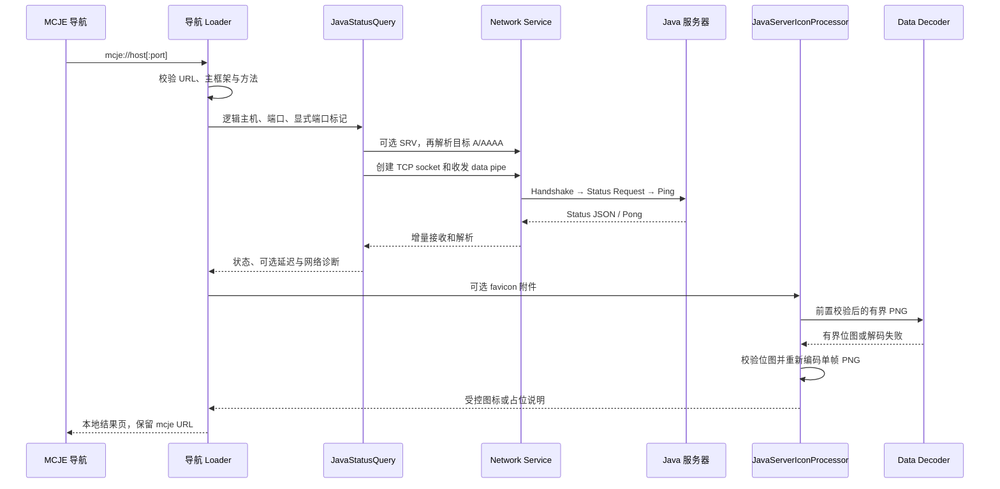
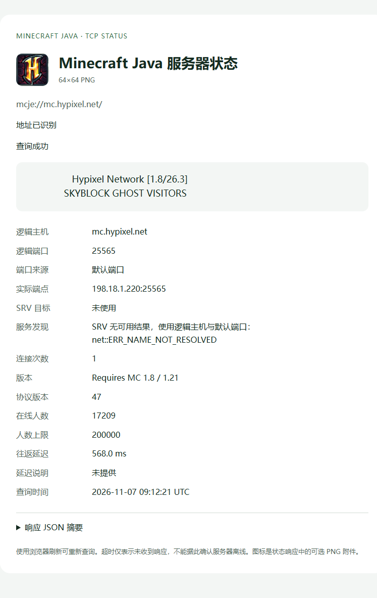

# 原生 mcje:// 协议与 Java 服务器状态、图标结果页首版实现方案

- 整理日期：2026-11-07（Asia/Shanghai）
- 项目：Chromium 158.0.8126.0，Windows x64 Debug 组件构建。
- 当前基础：提交 `23aca714af` 已实现原生 MCBE 导航、Bedrock UDP 查询和本地结果页。
- 已选方向：原生 `mcje://` 导航加载器 + Java Server List Ping（SLP）+ 本地生成结果页。
- 状态：阶段一至五已完成。产品构建和 GN 检查通过；最终运行的 92 项 MCJE 单测、11 项 MCBE 单测、两种模式各 34 项 MCJE 浏览器检查、17 项 MCBE 浏览器检查及 15 项 chromiumPlus 回归通过。已取得 Hypixel 公网状态与 64×64 图标，观察值和截图随文档保存；首次默认模式图标未显示的情况及环境限制见第 15 节。
- 相关文档：[MCBE 实现方案与验证记录](mcbe-native-protocol-implementation.md)、[chromiumPlus 默认字段实现与验证记录](globalthis-chromium-plus-implementation.md)。

## 1. 首版目标与范围

访问 `mcje://mc.hypixel.net`，浏览器通过 TCP 查询 Java 服务器状态，在当前标签页展示 MOTD、版本、协议号、在线人数、延迟和服务器图标。地址栏保留 MCJE URL，刷新会重新查询。

首版范围：

- 支持现代 Java SLP 报文格式（Minecraft Java 1.7 起使用的状态查询流程）。
- 支持域名、IPv4、方括号 IPv6、显式端口，以及未指定端口时的 DNS SRV 发现。
- MOTD 先转换为经过 HTML 转义的纯文本，支持字符串和常见文本组件结构。
- 将状态 JSON 的可选 `favicon` 附件解析为 PNG，在页面内显示标准 64×64 图标；缺失或损坏图标不影响其他状态信息。
- 展示目标地址、实际连接端点、SRV 目标、查询时间及有长度限制的响应 JSON 摘要。
- 继续使用固定本地 HTML / CSS，页面不需要 JavaScript。

首版中的 icon 指状态响应自带的 `favicon`，不是从服务器网站抓取 `/favicon.ico`。独立 PNG 文件下载、标签页 favicon 集成、彩色富文本 MOTD、玩家样本列表、自动轮询、游戏登录与加入服务器留到后续版本。

## 2. URL 语义与权限边界

支持示例：

```text
mcje://mc.hypixel.net
mcje://example.com:25565
mcje://example.com:25570/
mcje://192.168.1.10:25565/
mcje://[::1]:25565/
```

| 输入 | 逻辑端口 | SRV 行为 |
| --- | --- | --- |
| 域名，未写端口 | 25565 | 尝试 `_minecraft._tcp.<主机>`，无可用结果时回退 |
| 域名，显式写 `:25565` 或其他有效端口 | 用户指定端口 | 跳过 SRV |
| IPv4 / IPv6 字面量 | 未指定则 25565 | 跳过 SRV |

URL 校验沿用 MCBE 的规则：URL 长度不超过 2048 字节，路径仅为空或 `/`，拒绝非空用户信息、query 和初始导航中的 fragment，端口范围 `1..65535`。对握手主机名另做协议长度检查，规范化后的 ASCII 主机名不超过 255 字节。IPv6 连接使用去掉方括号的主机字符串，页面继续显示规范化 URL。

地址模型必须额外保存 `port_was_explicit`，不能只保存计算后的 `25565`，否则无法区分隐式默认端口与显式端口。还需分别保存原始逻辑目标、SRV 目标和最终 IP 端点。

注册统一常量 `chrome::kMcjeScheme`，在各相关进程初始化时使用 `SCHEME_WITH_HOST_PORT_AND_USER_INFORMATION` 注册标准 URL，并加入 `no_access_schemes`。保留用户信息供 Loader 拒绝输入，处理方式与 MCBE 一致。结果文档采用独立 opaque origin，不获得 WebUI、共享同源存储、CORS、Service Worker 或 secure scheme 能力。

仅接受当前主框架的 GET 文档导航；iframe、fetch、图片或其他资源请求不能触发 MCJE TCP 查询。初始地址无效时不建立连接。已经提交后的纯 fragment 变化遵循浏览器同文档导航规则，不重新查询。GURL 已判为无效的输入可能先由 Chromium 标准错误页处理。

## 3. 总体结构与当前源码接入点



| 作用 | 当前源码入口 |
| --- | --- |
| scheme 常量与注册 | [url_constants.h](../chrome/common/url_constants.h)、[ChromeContentClient::AddAdditionalSchemes()](../chrome/common/chrome_content_client.cc) |
| 已处理协议与地址栏分类 | [ProfileIOData::IsHandledProtocol()](../chrome/browser/profiles/profile_io_data.cc)、[ChromeAutocompleteSchemeClassifier](../chrome/browser/autocomplete/chrome_autocomplete_scheme_classifier.cc) |
| 非 HTTP 导航分发 | [CreateNonNetworkNavigationURLLoaderFactory()](../chrome/browser/chrome_content_browser_client.cc) |
| 已有 Loader 生命周期与响应写入模式 | [mcbe_url_loader_factory.cc](../chrome/browser/mcbe/mcbe_url_loader_factory.cc) |
| DNS / SRV Mojo 接口 | [host_resolver.mojom](../services/network/public/mojom/host_resolver.mojom) |
| SRV 提取、优先级与权重排序 | [dns_response_result_extractor.cc](../net/dns/dns_response_result_extractor.cc) |
| TCP 连接与收发流 | [NetworkContext::CreateTCPConnectedSocket()](../services/network/public/mojom/network_context.mojom)、[tcp_socket.mojom](../services/network/public/mojom/tcp_socket.mojom) |
| 异步 data pipe 监听 | [SimpleWatcher](../mojo/public/cpp/system/simple_watcher.h) |
| 隔离图片解码 | [data_decoder.h](../services/data_decoder/public/cpp/data_decoder.h)、[image_decoder.mojom](../services/data_decoder/public/mojom/image_decoder.mojom) |
| Base64、JSON 与 PNG 编码 | [base64.h](../base/base64.h)、[json_reader.h](../base/json/json_reader.h)、[png_codec.h](../ui/gfx/codec/png_codec.h) |

实现模块：

```text
chrome/browser/mcje/
  BUILD.gn
  mcje_url.h/.cc
  java_status_resolver.h/.cc
  java_status_protocol.h/.cc
  java_status_json.h/.cc
  java_status_query.h/.cc
  java_server_icon.h/.cc
  mcje_result_page.h/.cc
  mcje_url_loader_factory.h/.cc
  *_unittest.cc
  run_all_unittests.cc
chrome/browser/minecraft/
  BUILD.gn
  server_status_response.h/.cc
chrome/test/mcje_smoke_test.mjs
```

URL、SRV 解析、纯协议解析、TCP 查询、图片处理和页面生成分别承担独立职责。参考 MCBE 的 Loader 模式接入导航；两条路径可验证后，再提取实际共用的响应构造、固定样式和转义辅助函数。Bedrock UDP 与 Java TCP 查询继续使用各自的协议和结果模型。公共函数提取必须回归 MCBE，不能扩大其 CSP 或请求权限。

## 4. DNS SRV 与虚拟主机路由

查询 `_minecraft._tcp.<逻辑主机>` 时设置 `DnsQueryType::SRV`。SRV 的目标主机和端口通过 `ResolveHostClient::OnHostnameResults()` 返回，随后等待 `OnComplete()` 确认完成；不能把空的 `AddressList` 误判为 SRV 失败。

当前 `SimpleHostResolver` 的便捷回调只提供地址结果，不足以直接获取 SRV 主机列表。为 MCJE 实现专用 resolver，使用 NetworkContext 的 ResolveHost 接口，保留取消和断连处理。复用 Chromium 已按优先级及权重生成的目标顺序，不在业务层重新随机排序。

发现流程：

1. 显式端口或 IP 字面量直接进入 A/AAAA 解析或地址构造。
2. 其余域名启动 SRV 查询；本阶段最多占用 1 秒，同时受 5 秒网络总预算限制。
3. 有可用 SRV 记录时，从排序后的候选目标解析 A/AAAA；校验目标和端口，避免无界遍历。
4. 没有可用 SRV、查询失败或该阶段超时时，记录原因，使用原域名与逻辑默认端口继续查询。剩余预算不重置。
5. SRV 已选出目标后，连接失败只在有界候选中回退，不再静默改连原始默认端口。

当前 Chromium 的 `ExtractServiceResults()` 会过滤指向根域名的 SRV 目标，因此高层接口不能区分“仅有 target 为 `.` 的记录”和“没有可用 SRV 目标”。首版遵循现有接口，将空目标结果按上述回退处理；精确区分这种显式服务不可用记录需要后续扩展解析结果接口。

握手使用用户输入经规范化后的逻辑主机名和逻辑端口，TCP 则连接 SRV / DNS 选出的实际端点。例如输入 `mcje://example.com`，SRV 指向 `backend.example.net:25570`，TCP 连接后者，握手保留 `example.com:25565`。这两个地址必须独立保存和测试，不能把解析后的 IP 直接写进握手，影响代理服的虚拟主机路由。

## 5. Java SLP 编解码与结果模型

### 5.1 发送与接收流程

首版使用集中定义的探测协议号 `47`（Java 1.8），作为状态握手中的客户端协议参数。它不是服务器实际版本；服务器返回的 `version.name` 和 `version.protocol` 独立展示。后续若增加其他探测协议号，应通过显式兼容策略和测试调整，不自动遍历大量版本。

报文使用现代 SLP 的未压缩帧格式：`VarInt(报文长度) + VarInt(Packet ID) + Payload`。

| 报文 | ID | 关键内容 |
| --- | --- | --- |
| Handshake | `0x00` | 客户端协议号、UTF-8 逻辑主机名、无符号大端 16 位逻辑端口、`next_state = 1` |
| Status Request | `0x00` | 空 payload，处于 status 状态 |
| Status Response | `0x00` | VarInt 字节长度与 UTF-8 JSON 字符串 |
| Ping | `0x01` | 8 字节大端随机关联值 |
| Pong | `0x01` | 回显同一个 8 字节值 |

连接完成后，按顺序提交 Handshake、Status Request 和 Ping，不把发送 Ping 绑定在收到 JSON 之后，以兼容等待 Ping 才及时刷新响应的实现。记录 Ping 提交发送管道时的单调时钟时间，收到匹配 Pong 后计算客户端观测到的往返耗时。

接收端独立记录有效状态和匹配 Pong，处理一次读到多个帧或一个帧分多次到达。VarInt 解析结果区分“数据不足”“有效值”“格式无效”；拒绝超过 5 字节、溢出、负长度、超过应用上限和与字段布局不符的报文。已知报文必须校验 payload 消费完整，避免把后一个帧误当作当前 JSON 的尾部。

JSON 是必要的状态结果，Pong 用于补充延迟。两者齐备即可结束；状态已有效但 Pong 缺失、连接关闭或等待时间耗尽时保留状态，将延迟显示为“未取得”。收到有效状态后，等待 Pong 最多使用剩余总预算中的 1 秒。无有效状态时，连接错误、非法数据和超时分别返回可诊断错误。

### 5.2 JSON 与文本组件

响应根节点必须是对象，`description` 必须存在且可按受支持的文本组件结构解释。`version`、`players` 可以缺省，缺失时显示“未提供”；出现时校验字段类型和数字范围。额外字段不导致整体解析失败。

- `description` 支持字符串、数组，以及含 `text`、`extra` 的对象；保留换行。
- `translate` 有文本 `fallback` 时优先使用，否则保留翻译键。首版不加载翻译资源，也不解释格式占位符；非空 `with` 参数以 ` [参数一, 参数二]` 附在 fallback / 键之后，并受同一文本预算约束。
- 移除 Java 已知的 `§` 颜色及样式码（`0..9`、`a..f`、`k..o`、`r`，不区分大小写），未知格式码原样保留。颜色与粗体等富文本样式后续再实现。
- 不执行文本组件中的点击、悬停或命令事件，不把组件当 HTML。
- 在线人数和人数上限使用非负、范围内整数；不因服务端报告在线人数大于上限就拒绝状态。
- 协议号允许有符号 32 位整数，人数范围为 `0..2147483647`；JSON 数值在数学上为整数且处于范围内时接受（如 `1.0`）。版本名称最多 16 KiB。可选对象及其已知字段缺省时保持缺省，显式错误类型则拒绝状态。
- 图标始终是可选附件，验证失败单独记录，不把有效 JSON 状态改成查询失败。

建议结果模型：

| 字段 | 表示方式 |
| --- | --- |
| 逻辑目标 | host、logical_port、port_was_explicit、规范化 URL |
| 发现与连接信息 | 可选 SRV host/port、实际 IP 端点、回退说明 |
| 状态 | 纯文本 MOTD、可选版本名称与协议号、可选在线人数和上限 |
| 时延 | 可选 Ping/Pong RTT，不用 DNS / 连接耗时冒充 RTT |
| 图标 | 经过验证和重新编码的 PNG 字节，或缺失 / 无效原因 |
| 诊断 | 响应 JSON 摘要、可选附件与延迟诊断、完成时间 |
| 错误 | 地址、DNS、连接、网络超时、协议或 JSON 无效等类别 |

## 6. 服务器图标处理

图标来源只接受 `favicon` 字符串中的精确 PNG data URL 格式：

```text
data:image/png;base64,<Base64 数据>
```

处理顺序：

1. 在 Base64 解码前检查前缀与编码长度；解码后 PNG 文件最多 64 KiB。
2. 检查 PNG signature 和首个 IHDR，要求宽、高均为 64；拒绝其他格式和尺寸。
3. 使用 Data Decoder 服务进行隔离解码，关闭缩小适配，限制解码位图内存，验证结果仍为 64×64。
4. 当前 `ImageCodec::kPng` 只适用于 Ash；Windows 使用 `kDefault`，由前置 PNG 格式检查与后置位图校验约束输入和输出。
5. 将解码得到的单帧位图重新编码成 PNG，再检查输出上限，生成本地受控的 `data:image/png;base64,...`。
6. 将受控 data URL 放入固定 `` 模板，设置宽高与替代文本；解码失败、服务断连或图标阶段超时使用文本占位。

不接受服务器提供的远程图片 URL、SVG、任意 MIME 类型或 HTML 片段。解码服务只接收已通过前置限额的输入。PNG 重新编码避免把服务器原始的附加元数据直接传给结果文档；动画输入只使用解码得到的单帧结果。

## 7. 异步生命周期与限额

Query 和图标处理器由当前导航 Loader 分阶段持有，网络阶段通过 BrowserContext / StoragePartition 获取 NetworkContext。DNS、SRV、TCP socket、SocketObserver、收发 data pipe、SimpleWatcher 和图片解码连接 / 回调统一纳入 Loader 的取消管理。

| 项目 | 首版约定 |
| --- | --- |
| 网络查询总预算 | 5 秒，覆盖 SRV、DNS、TCP、请求写入、状态与 Pong 等待 |
| SRV 阶段预算 | 最多 1 秒，占用上述总预算 |
| 连接尝试 | 最多 2 个候选 IP 端点，共享预算，兼顾地址族回退 |
| 状态已到达后的 Pong 等待 | 最多 1 秒，且不超过网络剩余预算 |
| 可选图标处理 | 网络结果完成后最多追加 2 秒；失败仍返回状态 |
| 单个状态帧与 TCP 累计输入 | 分别至多 1 MiB、2 MiB；未知 ID、不匹配 Pong 和重复匹配 Pong 共享 8 帧忽略预算，第二个状态响应直接拒绝 |
| JSON 深度 | 至多 64 层 |
| 文本组件遍历 | 深度至多 32 层、节点至多 1024、输出文本至多 16 KiB |
| 图标输入 / 重编码输出 | PNG 字节分别至多 64 KiB，Base64 字符串按对应膨胀量预先限长 |
| 图标位图 | 64×64，解码内存上限建议 64 KiB，禁止通过缩小超大图片满足尺寸限制 |
| 页面 JSON 摘要 | 图标内容替换为说明后，最多保留 32 KiB，按 UTF-8 边界截断并明确标注 |
| 本地 HTML 响应 | 保持 512 KiB 上限，按 HTML 转义和 Base64 编码后的实际长度核算 |

候选地址与 SRV 记录只进行有界选取，不为每个地址重新获得完整 5 秒。阶段计时器和总计时器统一汇入一次性完成入口，检查完成状态并使过期 WeakPtr 回调失效。

离开页面、取消导航、Loader Mojo 断开、WebContents 销毁和 Profile 关闭时停止查询，关闭 socket 与 data pipe，撤销 watcher、DNS 及解码回调。所有网络与解码操作异步执行；UI 线程不做阻塞 socket 读取。为 TCP 状态查询增加项目要求的网络流量注解。

## 8. 本地结果页与响应头

页面展示：服务器图标或占位、MOTD、MCJE 地址、逻辑主机和端口、可选 SRV 目标、实际端点、版本和协议号、人数、可选延迟、查询时间，以及可展开的响应 JSON 摘要。JSON 摘要明确标注图标内容已单独处理和可能的截断，不把它宣称为完整原始响应。

沿用固定模板、全部远端文本转义和完整 HTML 导航响应。响应设置 `text/html; charset=utf-8`、`Cache-Control: no-store`、`X-Content-Type-Options: nosniff`、`Referrer-Policy: no-referrer`，CSP 为：

```text
default-src 'none'; style-src 'unsafe-inline'; img-src data:;
base-uri 'none'; form-action 'none'; frame-ancestors 'none'
```

`img-src data:` 只加入 MCJE 结果页，现有 MCBE 页面策略保持原有范围。HTML 上限包含 PNG Base64、MOTD 和 JSON 的转义膨胀；字段超限时按约定拒绝或截断，不能等到写入 data pipe 时才发现正常结果无法展示。

## 9. 实施步骤与阶段验收

### 阶段一：URL 与 scheme 接入

1. 新增 `kMcjeScheme`，按既有 MCBE 模式注册标准 scheme 和 no-access origin。
2. 接入已处理协议判断与 BrowserClient 非 HTTP 导航工厂分发。
3. 实现独立地址模型，保留显式端口标记和握手逻辑目标。
4. 加入域名、IPv4/IPv6、默认 / 显式端口、非法组成部分、长度和 opaque origin 单元测试。

验收：地址栏输入被分类为 URL；主框架导航走专用工厂，非法输入不发起连接；显式 `:25565` 不丢失语义。

### 阶段二：纯 SLP 编解码与文本解析

1. 实现 VarInt、帧边界、Handshake、Status Request、Ping/Pong 编解码。
2. 实现支持拆包和连续帧的增量解析器，固定输入、状态和未知帧限额。
3. 实现 JSON 字段模型、文本组件展开和 JSON 摘要生成。
4. 加入各字节截断、错误 ID / 长度、VarInt 溢出、UTF-8、字段缺省、嵌套和文本限额测试。

验收：无需网络即可验证协议；JSON 和 Pong 独立关联，MOTD 中的 HTML 仅作为文本。

### 阶段三：SRV、TCP 与取消

1. 实现专用 SRV resolver，接收 `OnHostnameResults()` 和完成状态；加入可注入解析结果的测试接缝。
2. 实现 A/AAAA 解析、候选选择、TCP 创建与异步 data pipe 收发。
3. 接入 5 秒总预算、SRV 子预算、最多两次连接和状态后的短 Pong 等待。
4. 接入断连、导航取消和 BrowserContext 生命周期清理，确保回调至多一次。
5. 使用本地模拟 TCP 服务器检查握手域名 / 端口、SRV 跳转、拆包、超时及部分成功行为。

验收：连接 SRV 实际端点时，握手仍携带原始逻辑目标；Pong 缺失不抹掉已获取的状态；取消后不再连接或回退。

### 阶段四：PNG 附件与页面

1. 实现 PNG data URL、Base64、文件大小和 IHDR 校验。
2. 接入隔离图片解码、单帧 PNG 重编码与可选阶段超时。
3. 实现固定图标、占位与状态模板，设置 MCJE 专用 CSP。
4. 复用已确认共用的响应辅助逻辑，校验完整 HTML 上限和 data pipe 写入。

验收：合法 64×64 图标显示；损坏、超大、非 PNG 和错误尺寸附件仅产生图标占位；图标解码不阻塞 UI。

### 阶段五：构建、端到端验证与记录

1. 补齐 GN 目标和依赖检查，构建产品与独立 MCJE 单元测试程序。
2. 编写 Node 内置 TCP + CDP 的浏览器回归脚本，使用独立临时 Profile、本地状态服和固定 PNG 测试数据。
3. 分别运行默认网络服务模式与 `NetworkServiceInProcess2` 诊断模式，记录结果和日志。
4. 实测 `mcje://mc.hypixel.net/`，记录当次返回字段与图标截图；线上返回值不作为固定断言。
5. 回归 MCBE 和 `chromiumPlus`，验证地址栏、刷新、后退 / 前进、取消与关闭浏览器。
6. 更新本文为实际实施记录，再单独提交功能实现、测试与文档更新。

验收：本地确定性测试通过，Hypixel 查询与图标显示具备实测记录，已有功能回归通过，环境限制与未通过项目如实记录。

## 10. 测试矩阵与拟用命令

| 层次 | 至少覆盖 |
| --- | --- |
| URL | 大小写规范化、默认端口、显式 `:25565`、IPv4/IPv6、用户信息、非法路径 / query / 初始 fragment |
| DNS / SRV | 成功目标、无记录、失败与超时回退、显式端口跳过、排序消费、有界候选与逻辑握手目标 |
| TCP / 帧 | 分段读写、多个帧合并、VarInt 超长 / 溢出 / 负长度、异常 ID、提前关闭、连接回退 |
| 状态 JSON | UTF-8、字段缺省与类型错误、人数边界、字符串 / 对象 / 数组 MOTD、嵌套与输出上限 |
| Ping/Pong | 匹配和不匹配关联值、Pong 缺失但状态有效、状态缺失、总超时 |
| 图标 | 正常及透明 PNG、缺失、非法 Base64、MIME 不符、签名 / IHDR 不符、超大文件、错误尺寸、解码失败和超时 |
| 页面 | 图片实际解码成功和 64×64 自然尺寸、HTML 转义、CSP、opaque origin、JSON 摘要截断与 HTML 上限 |
| 生命周期 | 刷新、历史、取消、关闭标签页 / 浏览器、socket 或解码服务断连、子框架 / fetch 不建连 |
| 回归 | 现有 MCBE 浏览器检查、chromiumPlus 默认字段及其页面 / Worker 回归 |

拟新增目标和脚本后，使用以下命令；具体参数以实现后的脚本为准：

```powershell
gn check out/Debug '//chrome/browser/mcje:*'
autoninja -C out/Debug chrome mcje_unittests
out/Debug/mcje_unittests.exe --test-launcher-jobs=1 --test-launcher-summary-output=out/Debug/mcje-unit-results.json
node chrome/test/mcje_smoke_test.mjs --chrome-binary=out/Debug/chrome.exe --output=out/Debug/mcje-smoke-default.json --public-host=mc.hypixel.net
node chrome/test/mcje_smoke_test.mjs --chrome-binary=out/Debug/chrome.exe --output=out/Debug/mcje-smoke-in-process.json --public-host=mc.hypixel.net --screenshot=out/Debug/mcje-result.png --chrome-arg=--enable-features=NetworkServiceInProcess2
out/Debug/mcbe_unittests.exe --test-launcher-jobs=1
node chrome/test/mcbe_smoke_test.mjs --chrome-binary=out/Debug/chrome.exe --output=out/Debug/mcbe-mcje-regression.json
python chrome/test/chromium_plus_smoke_test.py --chrome-binary out/Debug/chrome.exe --output out/Debug/chromium-plus-mcje-regression.json --chrome-arg=--enable-features=NetworkServiceInProcess2
```

SRV 重定向通过可注入 resolver / 本地 DNS 测试设施做确定性验证，不能仅依赖本机公网解析，也不能认为 `--host-resolver-rules` 的 A/AAAA 映射足以模拟完整 SRV。浏览器脚本应只清理其创建的进程与临时目录。

现有 Debug 环境在 MCBE 验证时曾出现默认网络服务启动后自动重启，恢复后 MCBE 的默认和诊断模式均通过。MCJE 需要重新验证 TCP 与图片解码服务，分别报告两种模式的结果；诊断参数不写入产品启动逻辑。

## 11. 阶段一实施记录

方案文档最初由提交 `25281292f3` 保存。本节记录阶段一当时的实现与验证结果，尚未进行 Hypixel 状态或图标查询。

### 11.1 已实现内容

- 增加 `kMcjeScheme`，注册支持 host / port / user information 的标准 scheme 和 no-access origin；接入内部已处理协议及 BrowserClient 工厂分发。
- [mcje_url](../chrome/browser/mcje/mcje_url.cc) 保存逻辑主机、逻辑端口、显式端口标记和 IP 字面量标记，`ShouldQuerySrv()` 只表达后续是否适用 SRV 的决策，不发起 DNS 查询。
- 地址默认 TCP `25565`，显式 `:25565` 和带前导零的端口规范化后仍保留显式语义；IPv6 主机去掉方括号，逻辑主机长度最多 255 字节。
- [mcje_url_loader_factory](../chrome/browser/mcje/mcje_url_loader_factory.cc) 仅接受当前主框架 GET 文档导航，返回本地地址确认页或地址错误页；确认页明确提示当前版本尚未提供服务器状态查询。
- [mcje_url_unittest.cc](../chrome/browser/mcje/mcje_url_unittest.cc) 覆盖域名规范化、默认及显式端口、IP 地址与 SRV 适用性、非法输入、握手主机长度和独立 opaque origin。
- 阶段一版本的 [mcje_smoke_test.mjs](../chrome/test/mcje_smoke_test.mjs) 以本地 TCP 监听器检查零连接，通过 `chrome://omnibox-internals` 的真实分类器检查 URL 输入类型；仅在其自行创建的临时 Profile 中启用内部调试页。该脚本现已随阶段三扩展为真实 TCP 查询回归。

阶段一未提取 MCBE 公共代码，未调整 MCBE CSP；当时的脚本只验证地址接入，不查询服务器状态。第十节的公网测试命令面向完整首版。

### 11.2 本阶段验证命令与结果

```powershell
autoninja -C out/Debug chrome mcje_unittests mcbe_unittests
gn check out/Debug '//chrome/browser/mcje:*'
out/Debug/mcje_unittests.exe --test-launcher-jobs=1 --test-launcher-summary-output=out/Debug/mcje-phase1-unit-results.json
out/Debug/mcbe_unittests.exe --test-launcher-jobs=1 --test-launcher-summary-output=out/Debug/mcbe-mcje-phase1-unit-results.json
node chrome/test/mcje_smoke_test.mjs --chrome-binary=out/Debug/chrome.exe --output=out/Debug/mcje-phase1-default.json
node chrome/test/mcje_smoke_test.mjs --chrome-binary=out/Debug/chrome.exe --output=out/Debug/mcje-phase1-in-process.json --screenshot=out/Debug/mcje-phase1.png --chrome-arg=--enable-features=NetworkServiceInProcess2
node chrome/test/mcbe_smoke_test.mjs --chrome-binary=out/Debug/chrome.exe --output=out/Debug/mcbe-mcje-phase1-regression.json
python chrome/test/chromium_plus_smoke_test.py --chrome-binary out/Debug/chrome.exe --output out/Debug/chromium-plus-mcje-phase1-regression.json --chrome-arg=--enable-features=NetworkServiceInProcess2
```

2026-11-07 在 Windows x64 Debug component build 中完成：

| 检查 | 结果 | 本地记录 |
| --- | --- | --- |
| `chrome`、`mcje_unittests`、`mcbe_unittests` 构建 | 通过 | `out/Debug/mcje-phase1-build-retry.log` |
| GN 头文件依赖检查 | 通过 | `gn check out/Debug '//chrome/browser/mcje:*'` |
| MCJE URL 单元测试 | 7 / 7 | `out/Debug/mcje-phase1-unit-results.json` |
| MCBE 单元测试回归 | 11 / 11 | `out/Debug/mcbe-mcje-phase1-unit-results.json` |
| MCJE 默认网络服务模式 | 11 / 11 | `out/Debug/mcje-phase1-default.json` |
| MCJE 进程内网络服务诊断模式 | 11 / 11 | `out/Debug/mcje-phase1-in-process.json` |
| MCBE 本地 UDP 浏览器回归 | 17 / 17 | `out/Debug/mcbe-mcje-phase1-regression.json` |
| `chromiumPlus` 页面与 Worker 回归 | 15 / 15 | `out/Debug/chromium-plus-mcje-phase1-regression.json` |

MCJE 浏览器检查覆盖真实地址栏分类、域名规范化、默认与显式端口、IPv4/IPv6、非法 URL、本地页面响应头与 CSP、刷新、历史导航、子框架 / fetch 拒绝及目标 TCP 零连接。初始导航携带 fragment 会被拒绝；已提交页面上的 fragment 变化属于同文档导航，保留原有页面且不触发加载器。`out/Debug/mcje-phase1.png` 已人工查看，地址与端口显示正常。C++ 格式、GN 格式、JavaScript 语法及 Git 空白检查通过。

首次完整链接遇到原有构建目录中 4 个损坏的 `.obj`（对象文件头或 CodeView 类型记录损坏），已逐个定位并重新生成，之后产品构建通过；修复仅涉及 `out/Debug/` 构建产物。默认模式日志仍出现已有的网络服务启动后自动重启现象，恢复后本阶段检查全部通过；进程内模式仅用于诊断，未写入产品配置。

本阶段可以访问 `mcje://mc.hypixel.net/` 查看本地地址确认页，默认端口为 `25565`。页面明确提示尚未提供服务器状态查询；这些结果不代表已连接 Hypixel，也不代表 SLP、SRV 或 PNG 图标功能已实现。

## 12. 阶段二实施记录

### 12.1 实际模块与接口

- [java_status_protocol.h/.cc](../chrome/browser/mcje/java_status_protocol.h)：三态 VarInt 解析、Handshake / Status Request / Ping 编码和有界增量接收器 `JavaStatusStreamParser`。Handshake 固定探测协议号为 `47`，使用逻辑主机、逻辑端口及 `next_state=1`；关联值完整保留 64 位，并使用大端编码。
- 接收器支持每字节拆分、多帧合并以及 JSON / Pong 任意先后顺序。单帧至多 1 MiB，累计输入至多 2 MiB；只保存当前未完成帧，不累计完整流。已知报文必须完整消费 payload，拒绝负长度、VarInt 溢出、异常布局和重复状态响应。
- `status()` 与 `pong_received()` 独立保存，`complete()` 表示两者齐备且未出错。`Feed()` 失败后错误保持不变；`Finish()` 检查提前关闭和缺失状态。状态已有效但没有 Pong 时正常结束仍可成功；后续坏帧或截断产生错误时，先前状态继续可读，由阶段三决定如何显示状态及延迟诊断。
- [java_status_json.h/.cc](../chrome/browser/mcje/java_status_json.h)：严格 UTF-8 / RFC JSON、字段模型 `JavaServerStatus`、有界文本组件展开和 JSON 摘要。文本原样保留 HTML 字符和换行，作为纯文本交付；后续结果页必须再做 HTML 转义。点击、悬停和命令元数据不参与文本输出。
- 文本支持字符串、数组、`text` / `extra` 对象和 `translate` / `fallback` / `with`，也接受仅含 `extra` 的对象和空数组。深度 32、节点 1024、展开文本 16 KiB 的预算包含遍历的数组、参数和追加标点，文本字节预算在移除格式码之前检查。JSONReader 的 64 层预算包含根节点及叶值。
- `favicon` 仅提取有界的不可信字符串，类型或长度无效单独记录到 `favicon_error`，不使有效状态失败。格式、Base64 和 PNG 解码留到阶段四；摘要中的该字段统一替换为附件省略说明，再序列化、按 UTF-8 边界截断，并在 32 KiB 总上限内追加明确提示。
- [java_status_protocol_unittest.cc](../chrome/browser/mcje/java_status_protocol_unittest.cc) 和 [java_status_json_unittest.cc](../chrome/browser/mcje/java_status_json_unittest.cc) 共新增 33 项测试；与 7 项 URL 测试一起由独立 `mcje_unittests` 运行。

截至阶段二，尚未接入 NetworkContext、DNS、SRV、TCP socket、计时器或图片服务，导航仍显示阶段一地址确认页；当时的纯协议测试不代表已经查询任何公网服务器。

### 12.2 构建与验证

```powershell
autoninja -C out/Debug mcje_unittests
out/Debug/mcje_unittests.exe --test-launcher-jobs=1 --test-launcher-summary-output=out/Debug/mcje-phase2-unit-results.json
gn check out/Debug '//chrome/browser/mcje:*'
autoninja -C out/Debug chrome
node chrome/test/mcje_smoke_test.mjs --chrome-binary=out/Debug/chrome.exe --output=out/Debug/mcje-phase2-navigation-regression.json
```

2026-11-07 在同一 Windows x64 Debug component build 中完成：

| 检查 | 结果 | 本地记录 |
| --- | --- | --- |
| `mcje_unittests` 构建 | 通过 | `out/Debug/mcje-phase2-unit-build.log` |
| 单元测试（新增 33 项及 URL 回归 7 项） | 40 / 40 | `out/Debug/mcje-phase2-unit-results.json` |
| GN 头文件依赖检查 | 通过 | `gn check out/Debug '//chrome/browser/mcje:*'` |
| `chrome` 产品构建与链接 | 通过 | `out/Debug/mcje-phase2-chrome-build.log` |
| 阶段一浏览器导航回归 | 11 / 11 | `out/Debug/mcje-phase2-navigation-regression.json` |
| C++ / GN 格式、空白和文档链接检查 | 通过 | 本地检查 |

单元测试覆盖已知编码字节、有符号 VarInt、每个字节位置的拆包与提前关闭、帧 / 累计输入 / 忽略报文边界、Pong 匹配、错误后的状态保留、字段类型、数字边界、无效 UTF-8、严格 JSON、嵌套 / 节点 / 文本限额、图标可选失败和摘要截断。浏览器回归确认原生导航、URL 语义、CSP、刷新 / 历史、子框架 / fetch 拒绝和目标 TCP 零连接仍正常。

阶段三将接入 SRV / TCP 与取消管理，再将本阶段纯函数用于真实网络字节流；目前未进行 Hypixel SLP 兼容性或图标显示测试。

## 13. 阶段三实施记录

### 13.1 网络查询与取消

- [java_status_resolver.h/.cc](../chrome/browser/mcje/java_status_resolver.h) 通过 `NetworkContext::ResolveHost()` 接收 SRV 主机列表和完成状态，`OnHostnameResults()` 不提前触发连接。实际 C++ 接口使用映射后的 `net::DnsQueryType`。每个请求持有显式取消 handle；销毁时关闭响应 pipe 并发送 `Cancel(ERR_ABORTED)`。
- [java_status_query.h/.cc](../chrome/browser/mcje/java_status_query.h) 统一管理 5 秒总预算、1 秒 SRV 预算、A/AAAA、TCP socket、SocketObserver、收发 data pipe、SimpleWatcher 和至多一次的完成回调。显式端口及 IP 字面量跳过 SRV；SRV 无有效结果、失败或超时时使用逻辑目标继续解析。
- 最多检查返回顺序中的前 16 条 SRV 结果，使用公开的主机名校验接口过滤无效目标，去重后保留前 2 个目标。DNS 排序保持不变；如果还有下一个 SRV 目标，当前目标的 A/AAAA 查询最多占用 1 秒。有效 SRV 目标选出后，失败只在这些候选中消费预算，不改连原始默认端口。
- 每个地址结果优先选第一个 IP，再选另一地址族；没有另一族时选第二个不同 IP。跨所有 SRV 目标合计最多 2 次连接。若存在备用端点，第一次连接最多使用剩余预算的一半；只对连接建立失败或超时进行回退，不对已经连接后的非法 SLP 响应重复连接。
- TCP 始终连接实际 IP 与发现端口，Handshake 则使用 URL 的逻辑主机和逻辑端口。发送方依次提交 Handshake、Status Request 和 Ping，支持 data pipe 的部分写入与反压；Ping 首次写入时记录单调时钟，匹配 Pong 后计算 RTT。
- 接收端异步增量读取；SocketObserver 的读错误或断连可能先于可读通知，必须排空已缓冲的数据后再处理 EOF。写错误也先检查缓冲响应。状态已有效时，Pong 缺失、提前关闭、坏 Pong 或超时保留状态，并将缺失延迟与原因单独记录；状态后的 Pong 等待不超过 1 秒，也不延长总预算。
- `Cancel()` / 析构无结果回调，撤销全部计时器和 WeakPtr，关闭 resolver、socket、观察者与 data pipe。连接回调另带尝试编号，过期连接成功返回的管道随回调参数销毁，不能触发发送或新回退。
- [mcje_url_loader_factory.cc](../chrome/browser/mcje/mcje_url_loader_factory.cc) 持有 Query，使用 WebContents 弱引用取得 NetworkContext；在新主框架导航、Loader Mojo 断开、WebContents 销毁和 Profile 销毁通知中取消。完成结果回调前已释放全部查询 I/O。新增 `mcje_java_status` 网络流量注解。

为验证真实导航与取消，本阶段提前接入基础纯文本结果页，展示逻辑目标、实际端点、SRV / 回退说明、MOTD、版本、人数、可选 RTT 及有界 JSON 摘要。所有远端文本做 HTML 转义，继续使用 opaque origin、禁止脚本的 CSP、`no-store`、`nosniff` 和 `no-referrer`；PNG 图标、`img-src data:` 与完整页面模块仍留到阶段四，MCBE 未做公共代码重构。

### 13.2 测试与本地验证

- [java_status_query_unittest.cc](../chrome/browser/mcje/java_status_query_unittest.cc) 新增 25 项网络状态机测试，使用可注入的 NetworkContext、真实 Mojo 消息 / data pipe 和模拟时钟；SRV 主机列表、完成状态、失败、超时、晚到结果及端点顺序均可确定性控制。8 字节发送 pipe 强制覆盖部分写入和反压。与此前 40 项合计 65 项。
- [mcje_smoke_test.mjs](../chrome/test/mcje_smoke_test.mjs) 使用 Node 本地 IPv4 / IPv6 TCP 服务及 CDP，检查实际三帧握手顺序、逻辑主机 / 端口、拆包、乱序 Pong、Pong 缺失、提前关闭、非法 JSON、截断与总超时；还覆盖地址栏、安全响应头、HTML 转义、CSP、刷新、历史、无效 URL、子框架 / fetch 禁止建连以及导航 / 标签页 / 浏览器关闭。
- 浏览器脚本的普通运行只连接本地测试服务器。SRV 重定向通过上述可注入结果验证，没有用 `--host-resolver-rules` 冒充 SRV，也没有将公网 DNS 返回作为固定断言。

```powershell
autoninja -C out/Debug chrome mcje_unittests
gn check out/Debug '//chrome/browser/mcje:*'
out/Debug/mcje_unittests.exe --test-launcher-jobs=1 --test-launcher-summary-output=out/Debug/mcje-phase3-unit-results.json
node chrome/test/mcje_smoke_test.mjs --chrome-binary=out/Debug/chrome.exe --output=out/Debug/mcje-phase3-default.json
node chrome/test/mcje_smoke_test.mjs --chrome-binary=out/Debug/chrome.exe --output=out/Debug/mcje-phase3-in-process.json --screenshot=out/Debug/mcje-phase3.png --chrome-arg=--enable-features=NetworkServiceInProcess2
node chrome/test/mcbe_smoke_test.mjs --chrome-binary=out/Debug/chrome.exe --output=out/Debug/mcbe-mcje-phase3-regression.json
python chrome/test/chromium_plus_smoke_test.py --chrome-binary out/Debug/chrome.exe --output out/Debug/chromium-plus-mcje-phase3-regression.json --chrome-arg=--enable-features=NetworkServiceInProcess2
```

2026-11-07 在 Windows x64 Debug component build 中完成：

| 检查 | 结果 | 本地记录 |
| --- | --- | --- |
| `chrome` 与 `mcje_unittests` 最终构建 | 通过 | `out/Debug/mcje-phase3-build-final.log` |
| 单元测试（新增 25 项、既有 40 项） | 65 / 65 | `out/Debug/mcje-phase3-unit-results.json` |
| GN 头文件依赖检查 | 通过 | `gn check out/Debug '//chrome/browser/mcje:*'` |
| MCJE 默认网络服务模式 | 22 / 22 | `out/Debug/mcje-phase3-default.json` |
| MCJE 进程内网络服务诊断模式 | 22 / 22 | `out/Debug/mcje-phase3-in-process.json` |
| MCBE 本地 UDP 浏览器回归 | 17 / 17 | `out/Debug/mcbe-mcje-phase3-regression.json` |
| `chromiumPlus` 页面与 Worker 回归 | 15 / 15 | `out/Debug/chromium-plus-mcje-phase3-regression.json` |
| C++ / GN 格式、JavaScript 语法、空白及文档链接 | 通过 | 本地检查 |

两次 MCJE 浏览器运行各建立 18 次本地 TCP 连接，服务端未发现非法握手；无效地址、子框架 / fetch 和取消后的等待均未增加连接。`out/Debug/mcje-phase3.png` 已查看，纯文本 MOTD、版本、人数、实际端点、RTT 及摘要显示正常，HTML 字符作为文字显示且没有生成图片或脚本。

默认模式仍出现已有的网络服务启动后自动重启一次，恢复后 22 项检查全部通过；进程内诊断模式没有该重启日志，诊断参数没有写入产品逻辑。SRV 重定向及超时回退是注入解析结果的 Mojo / 状态机验证，浏览器 TCP 检查使用真实本地 socket；本阶段未进行 Hypixel 公网兼容性或 PNG 图标显示测试。

现在访问 `mcje://主机[:端口]/` 会发起 Java SLP 查询并显示基础文本结果。阶段四将增加经过隔离解码和重新编码的 PNG 图标及完整结果页。


## 14. 阶段四实施记录

### 14.1 PNG 附件与取消

- 新增 [java_server_icon.h/.cc](../chrome/browser/mcje/java_server_icon.h)，由导航 Loader 独占单次 `JavaServerIconProcessor`。仅接受精确的 `data:image/png;base64,` 前缀；在 Base64 解码前限制编码长度，采用严格解码并核对规范编码，拒绝空白、非法字符和非规范 padding bits。解码后的 PNG 不超过 64 KiB。
- 检查 PNG signature、首个 IHDR 的 13 字节长度、完整头部与 CRC 所占空间，以及 64×64 宽高。完整 PNG 与压缩像素的验证交给隔离图片服务；浏览器进程不直接解码服务器的原始 PNG。
- 处理器显式持有 `data_decoder::DataDecoder` 与 `ImageDecoder` 两条连接，通过 `GetService()->BindImageDecoder()` 调用 `DecodeImage()`。Windows 使用 `ImageCodec::kDefault`、`shrink_to_fit=false`、64 KiB 位图预算和 64×64 首选帧尺寸。没有调用会把服务连接隐式保留到回调结束的 `DecodeImageIsolated()` 便捷函数。
- 返回后重新检查位图非空、可绘制、N32、64×64 及内存限额，再用 `PNGCodec::EncodeBGRASkBitmap(..., false)` 编码单帧 PNG。保留透明度，去除远端附加元数据和动画结构，并再次限制输出为 64 KiB。
- `JavaServerIcon` 的 data URL 字段只允许处理器写入；页面不能把 `JavaServerStatus::favicon` 原始字符串当图片使用。网络查询完成后最多追加 2 秒图标预算。附件缺失、类型或格式错误、解码失败、服务断连及超时均返回有说明的占位，不更改有效状态查询的成功结果。
- `Cancel()`、析构及超时关闭 ImageDecoder 和 DataDecoder 连接、停止计时器并使弱回调失效。Loader 在图标处理中继续响应新主框架导航、Loader Mojo 断开、WebContents 销毁和 Profile 关闭；取消不是仅忽略晚到回调。

### 14.2 正式结果页与公共响应

- 新增 [mcje_result_page.h/.cc](../chrome/browser/mcje/mcje_result_page.h)，统一显示固定 64×64 图标或占位、纯文本 MOTD、URL、逻辑主机和端口、显式端口来源、实际端点、SRV 目标、发现说明、连接次数、版本、协议号、人数、可选 RTT、延迟诊断、UTC 查询时间及 JSON 摘要。使用响应式布局和亮 / 暗配色；刷新继续通过浏览器原生导航发起查询。
- 服务器文本、错误说明和 JSON 摘要全部做 HTML 转义。图标只来自重新编码的受控 data URL，使用固定宽高和替代文本；没有远程图片、脚本或额外权限。摘要继续省略原始 favicon。
- 新增 [minecraft/server_status_response.h/.cc](../chrome/browser/minecraft/server_status_response.h)，复用 MCBE / MCJE 已一致的响应头、完整 data pipe 写入和完成状态逻辑。仅 MCJE 显式启用 `img-src data:`；MCBE 继续使用原有的禁止图片 CSP。`default-src 'none'`、禁止脚本、`no-store`、`nosniff`、`no-referrer` 及 opaque origin 保留。
- 公共发送器在创建 pipe 之前按实际 HTML 字节数检查 512 KiB 上限，包含全部转义膨胀和图标 Base64。pipe 按完整页面容量创建，检查整段写入结果后才发送响应；错误以资源不足完成导航。测试同时核算 MOTD、版本名和 JSON 摘要的最大转义膨胀，再预留最大图标和模板空间。

### 14.3 验证记录

单元测试使用真实 Mojo 消息与模拟时钟、可控的图片服务响应，验证前置校验、解码参数、返回位图再次检查、透明度保留、元数据不透传、断连、2 秒超时、主动取消、析构和晚到结果。PNG 的真实隔离解码由浏览器脚本覆盖，独立单测程序不初始化 Blink。

[mcje_smoke_test.mjs](../chrome/test/mcje_smoke_test.mjs) 使用 Node 自建带透明像素与 tEXt 元数据的 PNG，在本地 SLP 响应中返回。检查重新编码后的图片实际加载完成、自然尺寸 64×64、透明像素和半透明像素、原始元数据不出现在输出，以及附件缺失、错误类型、非法 Base64、空白、MIME 不符、远程 URL、错误尺寸、错误签名、损坏 PNG、编码超限及解码后超限时的占位和状态保留。继续覆盖原有网络、安全与导航生命周期。


```powershell
autoninja -C out/Debug chrome mcje_unittests
gn check out/Debug '//chrome/browser/mcje:*'
gn check out/Debug '//chrome/browser/minecraft:*'
gn check out/Debug '//chrome/browser/mcbe:*'
out/Debug/mcje_unittests.exe --test-launcher-jobs=1 --test-launcher-summary-output=out/Debug/mcje-phase4-unit-results.json
node chrome/test/mcje_smoke_test.mjs --chrome-binary=out/Debug/chrome.exe --output=out/Debug/mcje-phase4-default.json --screenshot=out/Debug/mcje-phase4.png
node chrome/test/mcje_smoke_test.mjs --chrome-binary=out/Debug/chrome.exe --output=out/Debug/mcje-phase4-in-process.json --chrome-arg=--enable-features=NetworkServiceInProcess2
node chrome/test/mcbe_smoke_test.mjs --chrome-binary=out/Debug/chrome.exe --output=out/Debug/mcbe-mcje-phase4-regression.json
python chrome/test/chromium_plus_smoke_test.py --chrome-binary out/Debug/chrome.exe --output out/Debug/chromium-plus-mcje-phase4-regression.json --chrome-arg=--enable-features=NetworkServiceInProcess2
```

2026-11-07 在 Windows x64 Debug component build 中完成：

| 检查 | 结果 | 本地记录 |
| --- | --- | --- |
| `chrome` 与 `mcje_unittests` 构建 | 通过 | `out/Debug/mcje-phase4-build-final.log` |
| 单元测试（新增图标 22 项、页面 / 响应 5 项，既有 65 项） | 92 / 92 | `out/Debug/mcje-phase4-unit-results.json` |
| MCJE、公共响应及 MCBE GN 头文件依赖检查 | 通过 | 本地 `gn check` |
| MCJE 默认网络服务模式 | 33 / 33 | `out/Debug/mcje-phase4-default.json` |
| MCJE 进程内网络服务诊断模式 | 33 / 33 | `out/Debug/mcje-phase4-in-process.json` |
| MCBE 本地 UDP 浏览器回归 | 17 / 17 | `out/Debug/mcbe-mcje-phase4-regression.json` |
| `chromiumPlus` 页面与 Worker 回归 | 15 / 15 | `out/Debug/chromium-plus-mcje-phase4-regression.json` |
| C++ / GN 格式、JavaScript 语法、Git 空白及文档链接检查 | 通过 | 本地检查 |

两种 MCJE 模式各建立 29 次本地 TCP 连接，均未发现非法握手。非法 URL、子框架 / fetch、远程图标与 CSP 拦截的外部图片没有引发额外连接。浏览器断言确认页面只有一张受控图标、自然尺寸 64×64、透明与半透明像素保持、原始 tEXt 元数据被去除；11 类缺失 / 异常附件均显示占位并保留成功 MOTD。`out/Debug/mcje-phase4.png` 已查看，图标、转义后的 MOTD、状态字段、查询时间和摘要入口显示正常。

默认模式仍记录已有的网络服务启动后重启一次，恢复后全部通过；进程内诊断模式没有该重启记录。图标解码无需启用进程内网络服务，诊断参数没有写入产品。服务断连、超时和图标处理中取消通过可控 Mojo 服务单测确定性验证；实际 PNG 隔离解码和显示通过上述浏览器检查验证。

本阶段只查询本地测试服务器；Hypixel 公网 SLP / SRV 兼容性、实际图标截图及最终验收提交留到阶段五。本轮没有创建提交，保留阶段一至四的未提交实现与文档更改。


## 15. 阶段五：构建、端到端验证与最终记录

### 15.1 完成的验收工作

- [mcje_smoke_test.mjs](../chrome/test/mcje_smoke_test.mjs) 新增可选 `--public-host` 和 `--public-screenshot`。不传公网参数时，仍只查询本地测试服务器；传入后额外通过真实 MCJE 导航查询一次实时 SLP，记录 DNS 观察值、页面字段、可选图标和截图。实时版本、人数、RTT 和 DNS 结果不作为固定测试期望。
- 公网查询失败会保存失败结果、返回非零退出码，并继续完成本地浏览器关闭检查和临时 Profile / 子进程清理。普通检查失败也保存最近一次页面状态，以区分网络失败、图标占位和页面断言失败。Node 的 DNS 观察只是诊断数据，没有注入 Chrome，也没有替代浏览器原生 DNS 查询。
- 按现有 GN 目标重新构建产品及两套独立单测，检查 MCJE、公共响应和 MCBE 的头文件依赖。复查 URL、纯协议、JSON、查询状态机、图标和 Loader 取消路径；本阶段没有修改产品超时、SRV 决策、解码器参数或网络服务配置。
- 在默认与 `NetworkServiceInProcess2` 诊断模式分别运行本地 / 公网检查，回归 MCBE 与 `chromiumPlus`。结果摘要保存在 [results-2026-11-07.json](mcje-validation/results-2026-11-07.json)，公开服务器截图保存在 [hypixel-2026-11-07.png](mcje-validation/hypixel-2026-11-07.png)，随实现一起纳入版本管理。

### 15.2 最终命令与结果

```powershell
autoninja -C out/Debug chrome mcje_unittests mcbe_unittests
gn check out/Debug '//chrome/browser/mcje:*'
gn check out/Debug '//chrome/browser/minecraft:*'
gn check out/Debug '//chrome/browser/mcbe:*'
out/Debug/mcje_unittests.exe --test-launcher-jobs=1 --test-launcher-summary-output=out/Debug/mcje-phase5-unit-results.json
out/Debug/mcbe_unittests.exe --test-launcher-jobs=1 --test-launcher-summary-output=out/Debug/mcbe-mcje-phase5-unit-results.json
node chrome/test/mcje_smoke_test.mjs --chrome-binary=out/Debug/chrome.exe --output=out/Debug/mcje-phase5-default.json --screenshot=out/Debug/mcje-phase5-local.png --public-host=mc.hypixel.net --public-screenshot=out/Debug/mcje-phase5-hypixel-default.png
node chrome/test/mcje_smoke_test.mjs --chrome-binary=out/Debug/chrome.exe --output=out/Debug/mcje-phase5-in-process.json --public-host=mc.hypixel.net --public-screenshot=out/Debug/mcje-phase5-hypixel-in-process.png --chrome-arg=--enable-features=NetworkServiceInProcess2
node chrome/test/mcbe_smoke_test.mjs --chrome-binary=out/Debug/chrome.exe --output=out/Debug/mcbe-mcje-phase5-regression.json
python chrome/test/chromium_plus_smoke_test.py --chrome-binary out/Debug/chrome.exe --output out/Debug/chromium-plus-mcje-phase5-regression.json --chrome-arg=--enable-features=NetworkServiceInProcess2
```

2026-11-07 在 Windows x64 Debug component build 中完成；下表为最终运行结果，首次失败另见 15.4：

| 检查 | 结果 | 原始本地记录 |
| --- | --- | --- |
| `chrome`、`mcje_unittests`、`mcbe_unittests` 构建 | 通过，产物已是最新 | `out/Debug/mcje-phase5-build.log` |
| MCJE、公共响应和 MCBE GN 头文件检查 | 全部通过 | `out/Debug/*phase5-gn-check.log` |
| MCJE 单元测试 | 92 / 92 | `out/Debug/mcje-phase5-unit-results.json` |
| MCBE 单元测试 | 11 / 11 | `out/Debug/mcbe-mcje-phase5-unit-results.json` |
| MCJE 默认网络服务模式 | 34 / 34（本地 33、公网 1） | `out/Debug/mcje-phase5-default.json` |
| MCJE 进程内网络服务诊断模式 | 34 / 34（本地 33、公网 1） | `out/Debug/mcje-phase5-in-process.json` |
| MCBE 本地 UDP 浏览器回归 | 17 / 17 | `out/Debug/mcbe-mcje-phase5-regression.json` |
| `chromiumPlus` 页面与 Worker 回归 | 15 / 15 | `out/Debug/chromium-plus-mcje-phase5-regression.json` |
| C++ / GN 格式、JavaScript 语法、空白与文档链接 | 通过 | 本地检查 |

两种 MCJE 模式各完成 29 次本地 TCP 连接；公网查询不计入本地监听器统计。本地测试覆盖实际握手、拆包 / 合包、Pong 顺序与缺失、错误响应、总超时、刷新、同文档导航、后退 / 前进、取消、关闭标签页和浏览器、子框架 / fetch 拒绝、PNG 异常占位、CSP、HTML 转义和独立 opaque origin。SRV 有效目标、排序消费、连接回退、超时与取消仍由可控 Mojo 单测验证，没有使用公网返回值替代确定性测试。

### 15.3 Hypixel 当次观察值

均访问 `mcje://mc.hypixel.net/`，未指定端口。下列数据仅描述当次返回，不保证后续保持一致。

| 字段 | 默认网络服务 | 进程内网络服务诊断模式 |
| --- | --- | --- |
| 查询完成时间（UTC） | 2026-11-07 09:12:21 | 2026-11-07 09:11:13 |
| 查询完成时间（Asia/Shanghai） | 2026-11-07 17:12:21 | 2026-11-07 17:11:13 |
| MOTD 第一行（省略前导空格） | `Hypixel Network [1.8/26.3]` | 同左 |
| MOTD 第二行（省略前导空格） | `SKYBLOCK GHOST VISITORS` | 同左 |
| `version.name` | `Requires MC 1.8 / 1.21` | 同左 |
| `version.protocol` | 47 | 47 |
| 在线人数 / 上限 | 17209 / 200000 | 17217 / 200000 |
| 匹配 Pong RTT | 568.0 ms | 803.0 ms |
| 逻辑目标 | `mc.hypixel.net:25565` | 同左 |
| 浏览器实际端点显示 | `198.18.1.220:25565` | 同左 |
| SRV | 无可用结果，回退逻辑主机 / 默认端口 | 同左 |
| TCP 连接次数 | 1 | 1 |
| 图标 | PNG，64×64，实际加载完成 | 同左 |
| 页面权限 | opaque origin、无脚本、非 secure context | 同左 |

`_minecraft._tcp.mc.hypixel.net` 在本次环境中没有可用 SRV 结果，Node 诊断记录为 `ENODATA`，Chrome 记录为 `net::ERR_NAME_NOT_RESOLVED` 后按方案回退。额外只读的 Google DNS-over-HTTPS 查询也返回无 Answer 的正常 DNS 响应；本次公网实测验证的是无记录回退路径，有效 SRV 重定向由单测覆盖。

当前环境的 A 记录为 `198.18.1.220`，处于基准测试保留网段，可能来自本机 DNS / 代理映射。浏览器在这个环境端点上取得了上述 SLP 和图标；该地址不能当作 Hypixel 的源站 IP 记录。没有修改用户 DNS、代理、路由或浏览器产品配置。

以下为默认模式实际结果页；进程内模式截图也已查看，原始文件保留在 `out/Debug/mcje-phase5-hypixel-in-process.png`。



### 15.4 首次失败与验收范围

默认模式首次运行时，本地 SLP 查询成功，但预期的合法 PNG 没有显示，图片数量断言为 0 而非 1；该次单项检查耗时约 2.9 秒。原始记录保存在 `out/Debug/mcje-phase5-default-initial.json` 及同名前缀日志。当次脚本尚未记录 `icon-state`，不能据此确认是解码超时、服务断连还是其他原因，未把“冷启动较慢”作为已证实结论。补充失败页诊断后，默认模式重跑 34 项全部通过；进程内模式 34 项也全部通过。产品的 2 秒可选图标预算和解码参数没有为通过测试而放宽；图标失败时保留有效状态仍是既定行为。

默认模式最终日志仍出现已有的网络服务启动后重启一次，恢复后完成所有检查；进程内诊断模式没有该记录。诊断启动参数仅用于测试。首版不承诺任意机器上的解码服务冷启动都能在 2 秒内完成，此时按设计使用图标占位。

本次完成首版阶段一至五，实现、测试、公共响应提取、文档及验证截图合并为一次功能提交。首版仍按既定范围提供现代 Java SLP、纯文本 MOTD 和可选 PNG 附件；标签页 favicon、图片下载、彩色富文本、登录 / 加入服务器和其他后续功能不包含在本次验收中。
